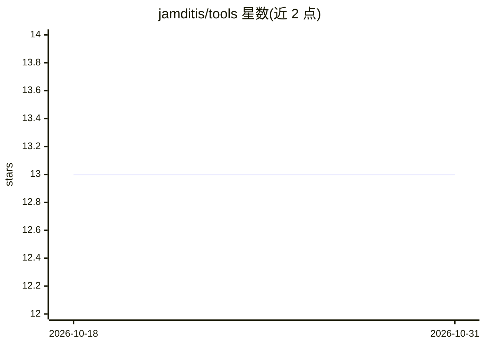

# jamditis/tools

⭐ 13 · HTML · 推送 2026-09-14 · [GitHub](https://github.com/jamditis/tools) · [官网](http://tools.amditis.tech/) · 个人维护

**面向记者与开发者的 AI 工具、模板与指南资源合集**

由 Joe Amditis（Center for Cooperative Media）维护的 AI 资源套件：托管于 GitHub Pages 的网站提供 vibe coding 教程、LLM 选型决策树、工具栈清单等指南；仓库内提供可下载的 LESSONS.md 与 CLAUDE-RULES 项目模板（软件开发与新闻出版两类）、Claude Code 技能安装说明、以及 Anime.js v4 完整文档。模型与工具指导注明于 2026-07-24 核验，并提示读者使用前自行复核可用性与价格。

## 筛选速览

| 维度 | 判定 | 备注 |
|---|---|---|
| AI 角色 | `ai-knowledge` | 知识聚合/清单类 |
| 许可风险 | `none` | — |
| 部署形态 | `library` | 以包/库形式分发 |
| 模型依赖 | — | README 未给出锁定关系 |
| 硬件要求 | — | 无带数字的原话,不猜 |
| 安装摩擦 | `low` | 无编译、无系统依赖或容器化 |
| 成熟度 | — | 结构信号不足 |

## 能力要点

- LLM Advisor 决策树工具辅助按任务选模型
- 14 种 CLAUDE-RULES 模板与多场景 LESSONS.md 模板
- Claude Code 技能与插件安装说明（含 50+ 新闻技能外部仓库）
- 多页 vibe coding 教程与打印版速查卡

## 适用场景

- 为新闻编辑室挑选合适的 AI 模型与工具栈
- 复制现成模板为项目建立 AI 协作上下文（CLAUDE.md/LESSONS.md）
- 学习 AI 辅助开发流程与提示语言写法

## 场景标签

`教程课程` `精选清单` · 领域:学习与行业

## 证据(README 行号)

> L5: A collection of AI tools, templates, and guides for journalists and developers. Created by **Joe Amditis** and hoste
> L20: |Vibe coding guide|Multi-page tutorial on AI-assisted development|
> L31: |LLM Advisor|Decision tree tool for selecting the right AI model for your task|

## 星数曲线

2026-10-18 13 → 2026-10-31 13（+0）

---
*卡片 v1 · prompt 1.4 · 生成 2026-10-31 · 置信度 mid · 依据 README sha `4529433fda15` · [字段定义](../../DATASET.md)*
