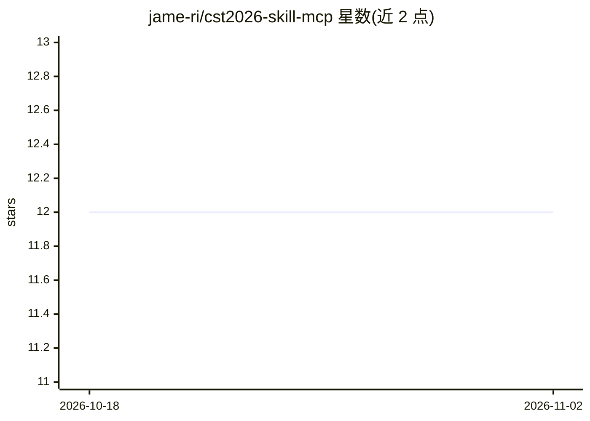

# jame-ri/cst2026-skill-mcp

⭐ 12 · HTML · 推送 2026-09-07 · [GitHub](https://github.com/jame-ri/cst2026-skill-mcp) · 个人维护 · 中文 README

**面向 AI agent 的 CST Studio Suite 电磁仿真自动化知识与工具库**

为 AI agent 提供 CST Studio Suite 自动化支持：包含双语 CST 自动化技能文件（SKILL.md）、一个无依赖的 MCP 服务器（提供宏搜索、官方文档读取、History/VBA 提取、设计记录与 CST Python 辅助工具的标准化调用）、天线设计演化等双语领域指南、可搜索的已安装宏索引及 CST 官方文档本地副本。附 Codex、Claude、Cursor 的 agent 配置示例与 Windows/macOS/Linux 启动脚本，CST 安装路径通过环境变量配置并可自动探测常见 CST 2026 路径。需本机已安装 CST。

## 筛选速览

| 维度 | 判定 | 备注 |
|---|---|---|
| AI 角色 | `ai-ecosystem` | LLM/agent 周边工具 |
| 许可风险 | `none` | — |
| 部署形态 | `None` |  |
| 模型依赖 | — | README 未给出锁定关系 |
| 硬件要求 | — | 无带数字的原话,不猜 |
| 安装摩擦 | `low` | 无编译、无系统依赖或容器化 |
| 成熟度 | — | 结构信号不足 |

## 能力要点

- 无依赖 MCP 服务器：宏搜索、官方文档读取、History/VBA 提取、设计记录、Python 辅助工具
- 双语（英文/中文）CST 自动化技能文件与领域指南（天线演化、几何变异、结果诊断、优化/数据/模型版本管理）
- Codex、Claude、Cursor 的 agent 配置示例与跨平台 MCP 启动脚本
- CST 安装路径经环境变量配置，启动脚本可自动探测常见 CST 2026 路径

## 适用场景

- 让 Claude/Codex/Cursor 等 agent 按 CST 自动化工作流操作电磁仿真
- 查找并复用本机已安装的 CST 宏
- 为 agent 提供天线设计演化与结果诊断的领域指导

## 场景标签

`工作流自动化` · 领域:效率与自动化

## 证据(README 行号)

> L3: This repository is a CST Studio Suite automation knowledge base for AI agents.
> L9: - A no-dependency MCP server for standardized CST reference and helper tools in `mcp/`

## 星数曲线

2026-10-18 12 → 2026-11-02 12（+0）

---
*卡片 v1 · prompt 1.4 · 生成 2026-11-01 · 置信度 high · 依据 README sha `6ca421c53d92` · [字段定义](../../DATASET.md)*
