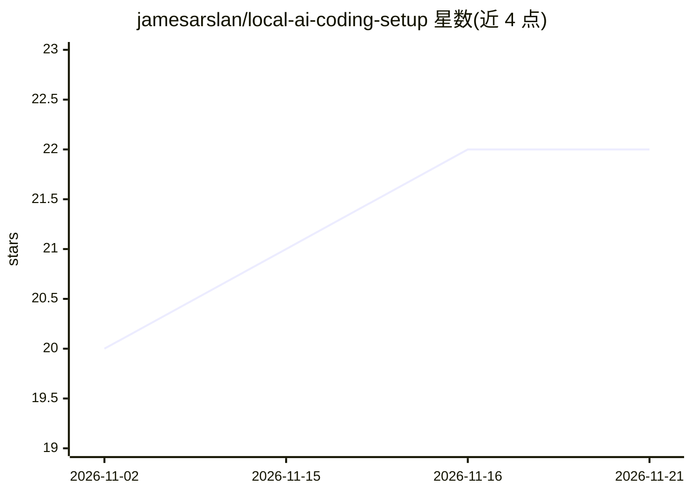

# jamesarslan/local-ai-coding-setup

⭐ 22 · Shell · MIT · 推送 2026-10-31 · [GitHub](https://github.com/jamesarslan/local-ai-coding-setup) · 个人维护

**RTX 5090 本地 AI 编程环境搭建指南：llama.cpp + Qwen + TurboQuant**

面向在自有 NVIDIA GPU 上搭建本地 AI 编程环境的教程型仓库：以 llama.cpp llama-server 运行 Qwen3.6/3.5 MoE 与 Gemma 4 模型，采用 TurboQuant turbo3 KV 压缩在 32GB 显存下实现 262K 上下文，记录生成速度与 VRAM 占用基准。工具层接入 OpenCode、Claude Code（经 llama-server）、Open WebUI 等；云端可选部署更大模型与 AnythingLLM RAG。提供 setup.sh 一键脚本与手动编译步骤，含多 GPU 兼容表与采样参数配置。云端组件（Mistral OCR MCP、Extract API）源码不在本仓库内。

## 筛选速览

| 维度 | 判定 | 备注 |
|---|---|---|
| AI 角色 | `ai-knowledge` | 知识聚合/清单类 |
| 许可风险 | `permissive` | MIT |
| 部署形态 | `desktop` | 安装包/桌面程序 |
| 模型依赖 | local-ok | 支持本地模型 |
| 硬件要求 | `gpu-24g` | |
| 安装摩擦 | `high` | 编译与系统依赖俱全 |
| 成熟度 | — | 结构信号不足 |

## 能力要点

- Qwen3.6-35B-A3B（Gated DeltaNet 架构）本地 ~177 t/s，262K 上下文
- TurboQuant turbo3 KV 压缩：3.5x 压缩，~25GB VRAM 跑 262K 上下文
- setup.sh 一键安装 CUDA、编译 llama.cpp 并生成配置
- 多 GPU 兼容表（RTX 3090–5090、M4 Max）与各模型推荐采样参数

## 适用场景

- 在 RTX 5090/4090 等 GPU 上搭建本地模型编程环境
- 通过 OpenCode / Claude Code 用本地模型进行 agentic 编程
- 了解 TurboQuant KV 压缩在长上下文推理中的显存收益

## 场景标签

`教程课程` · 领域:学习与行业

## 证据(README 行号)

> L3: A complete guide to building a local-first AI-powered coding environment that runs on your hardware — plus an option
> L7: An AI coding setup spanning two machines:
> L31: ## Quick Start

## 星数曲线

2026-11-02 20 → 2026-11-21 22（+2）

---
*卡片 v1 · prompt 1.4 · 生成 2026-11-18 · 置信度 high · 依据 README sha `3695f92441ca` · [字段定义](../../DATASET.md)*
