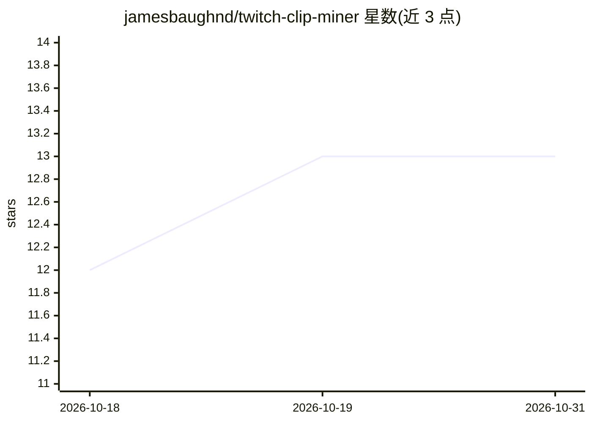

# jamesbaughnd/twitch-clip-miner

⭐ 13 · Python · MIT · 推送 2026-04-28 · [GitHub](https://github.com/jamesbaughnd/twitch-clip-miner) · 个人维护

**自动从 Twitch 直播回放中检测并剪出高光片段的 CLI 工具**

面向 Twitch 主播/剪辑者的本地命令行工具：读取 VOD URL 或本地视频，以音频能量峰为候选窗口，结合响度、转录文本、聊天速度与面部情绪四路信号加权打分，导出短视频片段及每段 insights JSON 与剪辑建议；支持 NVIDIA CUDA/AMD Vulkan/CPU 自动切换、断点分块处理超长 VOD、9:16 竖屏输出，whisper.cpp 可作转录后端。需 Python 3.10–3.12 与 FFmpeg，通过 git clone 加 requirements.txt 安装运行。

## 筛选速览

| 维度 | 判定 | 备注 |
|---|---|---|
| AI 角色 | `ai-native` | 本体是模型或模型工具 |
| 许可风险 | `permissive` | MIT |
| 部署形态 | `desktop` | 安装包/桌面程序 |
| 模型依赖 | — | README 未给出锁定关系 |
| 硬件要求 | — | 无带数字的原话,不猜 |
| 安装摩擦 | `medium` | 含编译或系统依赖之一 |
| 成熟度 | — | 结构信号不足 |

## 能力要点

- 四信号加权评分（响度/转录/聊天速度/面部情绪）选出高光片段
- GPU 自动检测：NVIDIA CUDA、AMD Vulkan 或 CPU 回退
- 可断点分块处理 10 小时级 VOD，结果缓存可复用
- 一键 9:16 竖屏输出，适配 TikTok/Shorts

## 适用场景

- 把长篇直播回放自动剪成可发布的短视频片段
- 不想全程盯着回放找高光的主播快速筛选素材
- 本地离线处理保持隐私，不上传视频

## 场景标签

`图像视频处理` · 领域:感知与多模态

## 证据(README 行号)

> L9: - **Multi‑signal detection** – combines audio energy, transcribed speech, chat velocity, and facial reactions for pi

## 星数曲线

2026-10-18 12 → 2026-10-31 13（+1）

---
*卡片 v1 · prompt 1.4 · 生成 2026-10-31 · 置信度 mid · 依据 README sha `973d8cc981c2` · [字段定义](../../DATASET.md)*
