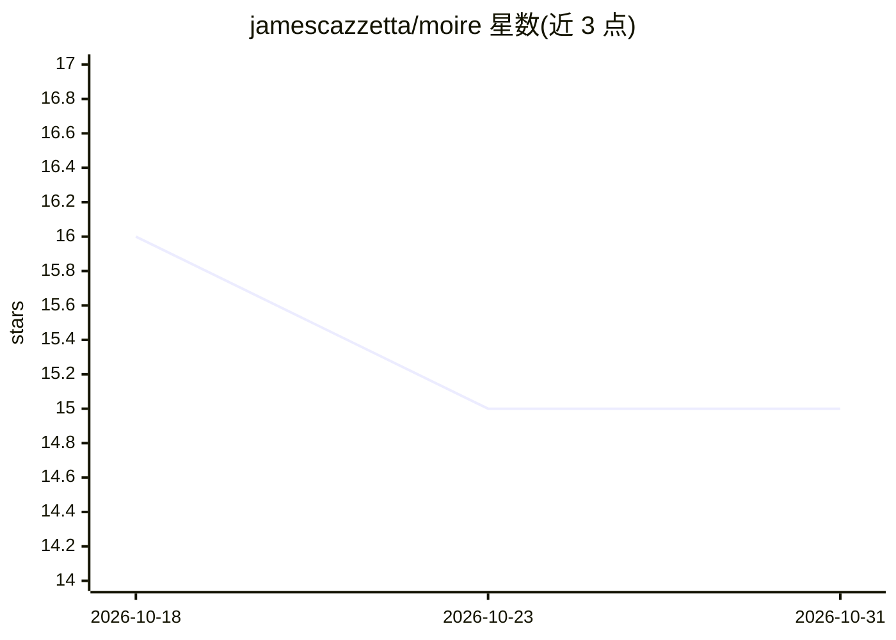

# jamescazzetta/moire

⭐ 15 · Shell · MIT · 推送 2026-08-25 · [GitHub](https://github.com/jamescazzetta/moire) · 个人维护

**检测并行 AI 编程 agent 间未提交工作冲突的 git 工具**

面向同时运行多个 AI 编程 agent 的开发者：在 git worktree 各自工作的 agent 无需感知或配合，moire 读取其未提交改动（含 staged/unstaged/untracked），在临时空间用 git merge-tree 做合并预演，在双方仍在编写时报告文本冲突，warn-only 从不阻断。冲突 finding 采用内容寻址 id，双方各自计算得到相同 id。另提供可选的语义破坏检查 verify，其测得基率为 672 对干净合并 PR 中 0 例新破坏。单文件 Python 3.8+、仅标准库、需 git ≥ 2.38，源码 clone 加 symlink 安装。

## 筛选速览

| 维度 | 判定 | 备注 |
|---|---|---|
| AI 角色 | `ai-ecosystem` | LLM/agent 周边工具 |
| 许可风险 | `permissive` | MIT |
| 部署形态 | `None` |  |
| 模型依赖 | — | README 未给出锁定关系 |
| 硬件要求 | — | 无带数字的原话,不猜 |
| 安装摩擦 | `low` | 无编译、无系统依赖或容器化 |
| 成熟度 | — | 结构信号不足 |

## 能力要点

- 读取双方未提交改动，用 git merge-tree 预演合并并报告冲突
- finding id 内容寻址，双方独立计算一致，无需对方配合
- warn-only 设计，无阻断模式，check/verify/replay 不因 finding 非零退出
- 可选语义检查 verify 支持 per-repo 配置自定义 checker（如 tsc）

## 适用场景

- 多 agent 并行开发时提前发现即将发生的合并冲突
- 在 agent 仍保有上下文时解决冲突而非合并时
- 将冲突 finding 渲染为消息供另一 agent 验证与行动

## 场景标签

 · 领域:开发者工具/多 agent 协作

## 证据(README 行号)

> L3: **Catches collisions between parallel AI coding agents while both are still writing — on uncommitted work, without t
> L16: You run several AI coding agents at once. Each works in its own git worktree so they
> L38: After each file write, it runs a **dress rehearsal**: it combines your working tree

## 星数曲线

2026-10-18 16 → 2026-10-31 15（-1）

---
*卡片 v1 · prompt 1.4 · 生成 2026-10-30 · 置信度 high · 依据 README sha `20c955ce4109` · [字段定义](../../DATASET.md)*
