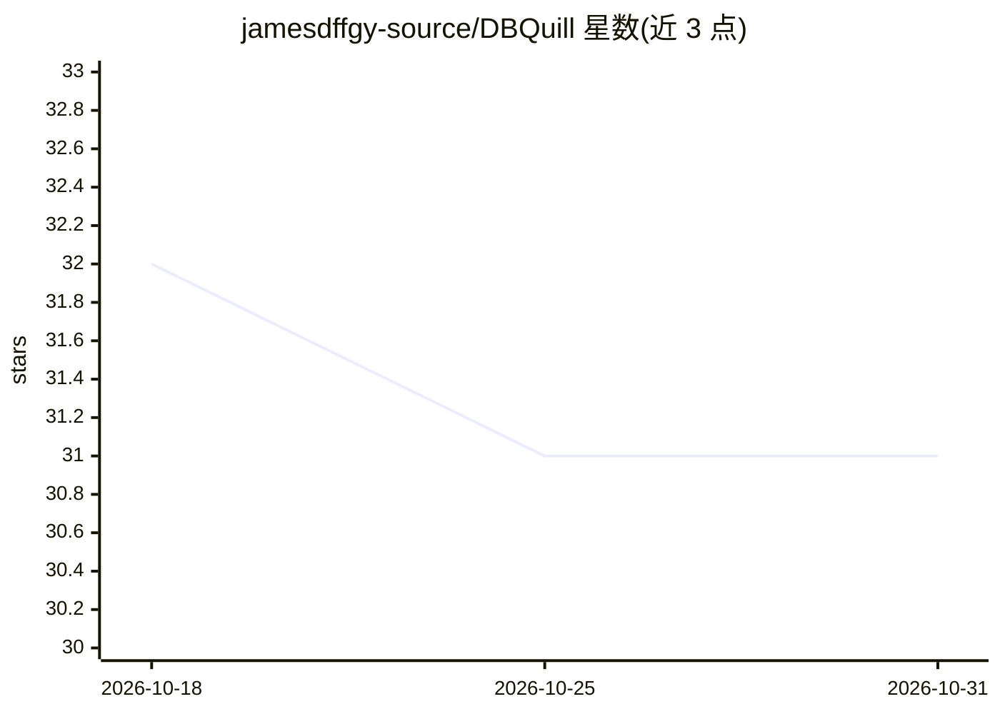

# jamesdffgy-source/DBQuill

⭐ 31 · Python · MIT · 推送 2026-10-14 · [GitHub](https://github.com/jamesdffgy-source/DBQuill) · 个人维护 · 中文 README

**本地优先的 Windows AI 数据库代理：自然语言查询与安全写入 SQLite/MySQL/PostgreSQL**

Windows 桌面 AI 数据库代理，将自然语言请求转换为经过审查的类型化数据库操作：读取路径物理只读且有行数限制，写入需经校验、变更预览与用户显式确认。支持附加 SQLite/CSV/.xlsx 文件并用自然语言描述任务，可连接只读或受控写入的 MySQL 8.4 / PostgreSQL 17，生成表格与图表，导出多工作表 .xlsx。模型作为规划输入而非权威，通过任何 OpenAI 兼容端点接入，凭据与审计记录留在本地。分发为源码形式，需 Windows 10/11 x64 与 Python 3.12。

## 筛选速览

| 维度 | 判定 | 备注 |
|---|---|---|
| AI 角色 | `ai-native` | 本体是模型或模型工具 |
| 许可风险 | `permissive` | MIT |
| 部署形态 | `None` |  |
| 模型依赖 | — | README 未给出锁定关系 |
| 硬件要求 | — | 无带数字的原话,不猜 |
| 安装摩擦 | `low` | 无编译、无系统依赖或容器化 |
| 成熟度 | `idea` | |

## 能力要点

- 读取默认单语句、行数受限、物理只读；写入需变更预览与显式确认
- 支持 SQLite、CSV、.xlsx 附加与 MySQL 8.4 / PostgreSQL 17 连接
- 接入任意 OpenAI 兼容文本模型端点，不绑定特定厂商
- 完成的读取路径可沉淀为局部、脱敏的只读策略并分层记忆

## 适用场景

- 用自然语言查询和可视化自己的数据库或表格文件
- 在受控确认流程下执行插入、更新等多工作表数据导入
- 以物理只读方式审查生产库的指标与对比分析

## 场景标签

`数据分析` · 领域:效率与自动化

## 证据(README 行号)

> L7: An open-source, local-first Windows AI database agent for querying, understanding, visualizing, and safely updating 
> L19: DBQuill turns a request into a typed, reviewable database operation before anything reaches the database. Read path
> L53: The command creates an isolated `.venv`, installs the hash-locked dependency set, runs environment diagnostics, and

## 星数曲线

2026-10-18 32 → 2026-10-31 31（-1）

---
*卡片 v1 · prompt 1.4 · 生成 2026-10-26 · 置信度 high · 依据 README sha `2b46a4db7e75` · [字段定义](../../DATASET.md)*
