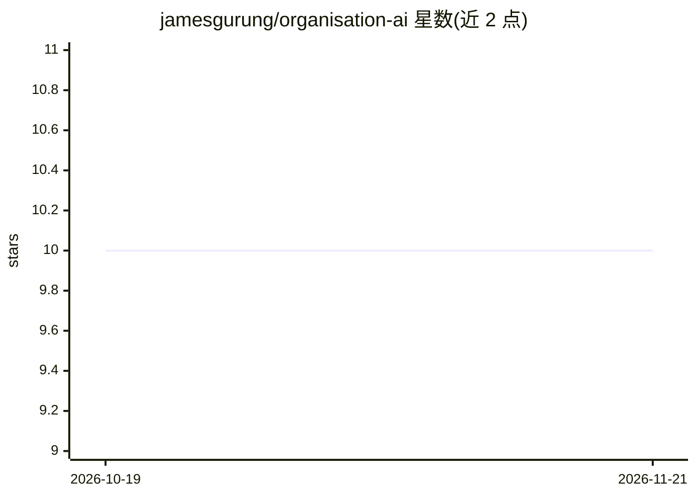

# jamesgurung/organisation-ai

⭐ 10 · JavaScript · MIT · 推送 2026-10-26 · [GitHub](https://github.com/jamesgurung/organisation-ai) · 个人维护

**为组织全员提供 OpenAI 聊天的开源 Web 应用**

面向学校及各类组织的多用户 AI 聊天 Web 应用，部署于 Azure App Service 并调用 Azure AI Foundry 托管的 OpenAI 模型。提供聊天界面、提示预设、网页搜索、向量库文件检索、图像生成、语音对话、聊天历史、内容审核与人工复查、每周消费限额与用量看板，并通过 Microsoft 365 SSO 登录。用户与用户组通过 config blob 容器中的 users.csv 与 JSON 配置管理。

## 筛选速览

| 维度 | 判定 | 备注 |
|---|---|---|
| AI 角色 | `ai-native` | 本体是模型或模型工具 |
| 许可风险 | `permissive` | MIT |
| 部署形态 | `None` |  |
| 模型依赖 | — | README 未给出锁定关系 |
| 硬件要求 | — | 无带数字的原话,不猜 |
| 安装摩擦 | `low` | 无编译、无系统依赖或容器化 |
| 成熟度 | — | 结构信号不足 |

## 能力要点

- 按用户组配置提示预设、模型与限额（users.csv + JSON 配置）
- 支持网页搜索、向量库文件检索、图像生成与语音对话
- 自动内容审核、人工复查与每周消费限额
- Microsoft 365 单点登录（SSO）

## 适用场景

- 为学校教职员工统一提供 AI 聊天访问
- 企业内按团队配置不同的提示预设与消费限额
- 需要对 AI 对话做审核与人工复查的组织

## 场景标签

`聊天机器人` `AI 助手` `图像生成` `语音 Agent` · 领域:对话与助手

## 证据(README 行号)

> L3: Organisation AI is a free, open-source web application that empowers your entire organisation with access to advance
> L5: Deploy effortlessly to Microsoft Azure and run OpenAI models hosted in Azure AI Foundry.
> L14: - Access to the latest OpenAI language models

## 星数曲线

2026-10-19 10 → 2026-11-21 10（+0）

---
*卡片 v1 · prompt 1.4 · 生成 2026-11-19 · 置信度 high · 依据 README sha `dcd77b3b52f2` · [字段定义](../../DATASET.md)*
