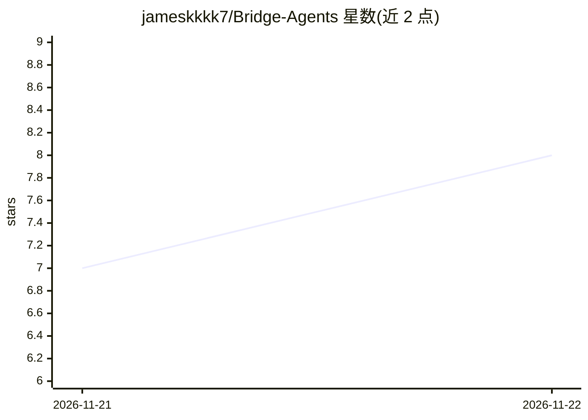

# jameskkkk7/Bridge-Agents

⭐ 8 · Python · Apache-2.0 · 推送 2026-11-20 · [GitHub](https://github.com/jameskkkk7/Bridge-Agents) · 个人维护 · 中文 README

**给企业做客服对话控制平面：可视化流程+引用式RAG**

自托管的 AI 客服对话控制平面，围绕两大支柱：拖拽画布编辑对话流程（保存即校验编译并热替换运行时，无需重新部署），以及以文档为锚的检索——标题感知分块、向量+词法混合检索、回复带 [1][2] 引用并可声明文档未覆盖。含可选 sanitize/review 守护节点、人工接管、typed tools 对接既有企业系统。FastAPI 实现，SQLite 默认存储，pip/uv、Docker Compose、systemd+nginx 均可部署。

## 筛选速览

| 维度 | 判定 | 备注 |
|---|---|---|
| AI 角色 | `ai-native` | 本体是模型或模型工具 |
| 许可风险 | `permissive` | Apache-2.0 |
| 部署形态 | `self-host` | docker 或自建部署 |
| 模型依赖 | — | README 未给出锁定关系 |
| 硬件要求 | — | 无带数字的原话,不猜 |
| 安装摩擦 | `low` | 无编译、无系统依赖或容器化 |
| 成熟度 | `idea` | |

## 能力要点

- 画布编辑流程为配置数据，保存时校验编译并热替换运行时
- RAG 默认内置：标题感知分块 + 向量(60%)/词法(40%)混合检索 + 引用输出
- typed tools 机制对接 IdP/CRM/工单等既有系统，凭据仅存服务端
- Studio 与客户界面提供英文和简体中文

## 适用场景

- 让运营人员不写代码地设计、修改客服对话流程
- 客服回答强制引用企业自有文档而非通用模型答案
- 通过 review 节点人工审核后再回复客户
- 通过 typed tools 让对话中查询订单、创建工单等实时数据

## 场景标签

`聊天机器人` `RAG` · 领域:对话与助手

## 证据(README 行号)

> L5: **Visual AI workflows for customer support, grounded in your documentation.**
> L32: Bridge-Agents is built around two product pillars — a visual workflow editor and
> L47: - **Control plane** — the visual graph, node settings and the support prompt,

## 星数曲线

2026-11-21 7 → 2026-11-22 8（+1）

---
*卡片 v1 · prompt 1.4 · 生成 2026-11-21 · 置信度 mid · 依据 README sha `1b5ef04ae27c` · [字段定义](../../DATASET.md)*
