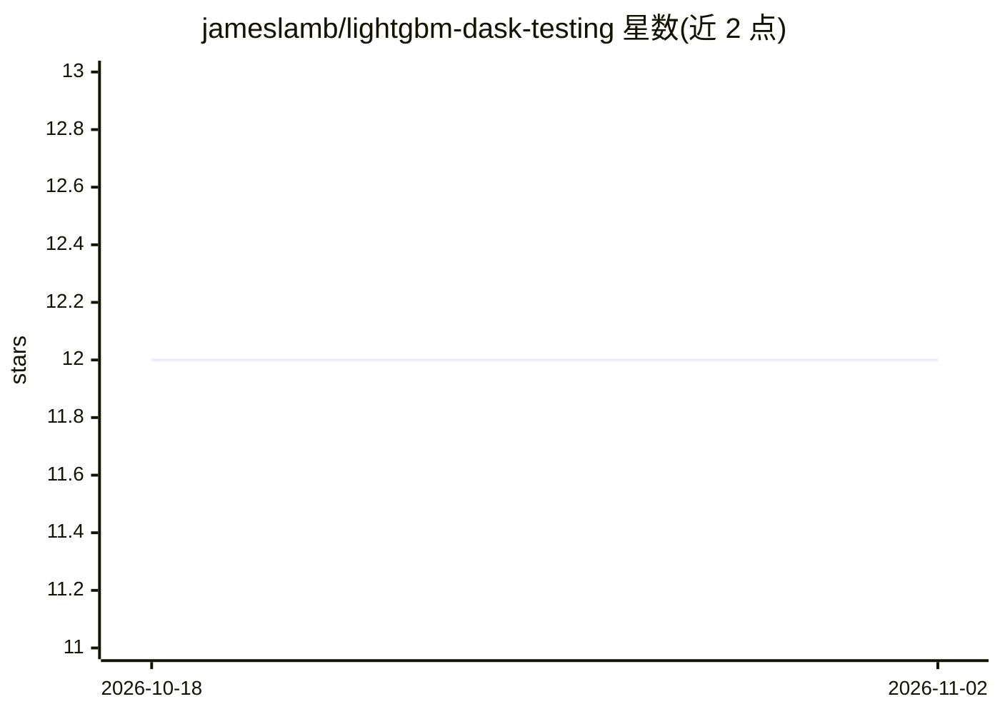

# jameslamb/lightgbm-dask-testing

⭐ 12 · Jupyter Notebook · BSD-3-Clause · 推送 2026-10-01 · [GitHub](https://github.com/jameslamb/lightgbm-dask-testing) · 个人维护

**LightGBM Dask 集成的开发与测试工具仓库**

用于测试和开发 LightGBM 的 Dask 集成改动：提供 make  recipes 构建含本地 LightGBM 副本的开发镜像并运行 JupyterLab；附带针对 LocalCluster（单机多 worker）与 dask-cloudprovider AWS FargateCluster（多机）的测试 notebook；支持将自定义容器镜像推送至 ECR Public、在容器化环境中运行 LightGBM 的 Dask 单元测试（可指定 DASK_VERSION），并内置 cProfile/snakeviz 运行时剖析与 memray 内存剖析流程。面向 LightGBM/Dask 贡献者与分布式机器学习开发者。

## 筛选速览

| 维度 | 判定 | 备注 |
|---|---|---|
| AI 角色 | `ai-ecosystem` | LLM/agent 周边工具 |
| 许可风险 | `permissive` | BSD-3-Clause |
| 部署形态 | `library` | 以包/库形式分发 |
| 模型依赖 | — | README 未给出锁定关系 |
| 硬件要求 | — | 无带数字的原话,不猜 |
| 安装摩擦 | `low` | 无编译、无系统依赖或容器化 |
| 成熟度 | — | 结构信号不足 |

## 能力要点

- make 一键构建含本地 LightGBM 的开发镜像并运行 JupyterLab
- 支持 LocalCluster 与 AWS FargateCluster 两种集群测试路径
- 容器化运行 LightGBM Dask 单元测试并可用 DASK_VERSION 切换 dask 版本
- 内置 cProfile/snakeviz 运行时剖析与 memray 内存剖析

## 适用场景

- 为 LightGBM Dask 集成复现问题或验证待合并的 PR
- 在多机 Fargate 集群上验证仅在真实分布式环境出现的问题
- 剖析 LightGBM 代码路径的运行时与内存开销

## 场景标签

 · 领域:分布式机器学习/测试基础设施

## 证据(README 行号)

> L5: This repository can be used to test and develop changes to LightGBM's Dask integration.
> L9: * Jupyter notebooks for testing `lightgbm.dask` against a `LocalCluster` (multi-worker, single-machine) and a `dask_

## 星数曲线

2026-10-18 12 → 2026-11-02 12（+0）

---
*卡片 v1 · prompt 1.4 · 生成 2026-11-01 · 置信度 mid · 依据 README sha `d11128fcb192` · [字段定义](../../DATASET.md)*
