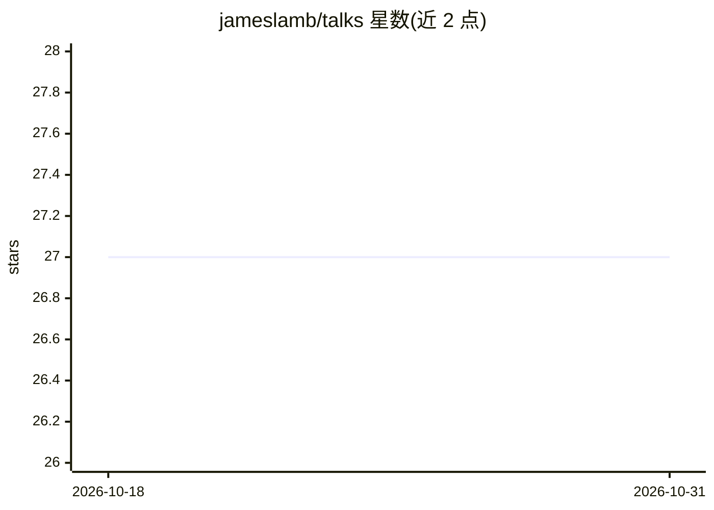

# jameslamb/talks

⭐ 27 · CSS · BSD-3-Clause · 推送 2026-09-01 · [GitHub](https://github.com/jameslamb/talks) · 个人维护

**个人演讲与文章存档：会议/聚会谈及播客博客链接清单**

James Lamb 的个人仓库，收录其在会议与聚会上所做演讲的标题、幻灯片/代码链接与视频链接，主题覆盖 LightGBM、Dask、开源参与、数据科学职业等；另列出参与的两期播客与三篇博客文章。README 提供表格化清单与联系方式（GitHub issue），无安装运行内容，属于个人作品集性质的信息页面。

## 筛选速览

| 维度 | 判定 | 备注 |
|---|---|---|
| AI 角色 | `ai-knowledge` | 知识聚合/清单类 |
| 许可风险 | `permissive` | BSD-3-Clause |
| 部署形态 | `library` | 以包/库形式分发 |
| 模型依赖 | — | README 未给出锁定关系 |
| 硬件要求 | — | 无带数字的原话,不猜 |
| 安装摩擦 | `low` | 无编译、无系统依赖或容器化 |
| 成熟度 | — | 结构信号不足 |

## 能力要点

- 按会议/聚会组织的演讲表格，含幻灯片与视频链接
- 收录播客与博客写作条目
- 提供 issue 或 GitHub 主页联系渠道

## 适用场景

- 查找 LightGBM/Dask 相关演讲的幻灯片与视频
- 了解作者的数据科学与开源参与经历

## 场景标签

`精选清单` · 领域:学习与行业

## 证据(README 行号)

> L3: This repository holds information on talks I've given at conferences and meetups.
> L16: |title|video(s)|

## 星数曲线

2026-10-18 27 → 2026-10-31 27（+0）

---
*卡片 v1 · prompt 1.4 · 生成 2026-10-26 · 置信度 mid · 依据 README sha `ed7010fe3bb4` · [字段定义](../../DATASET.md)*
