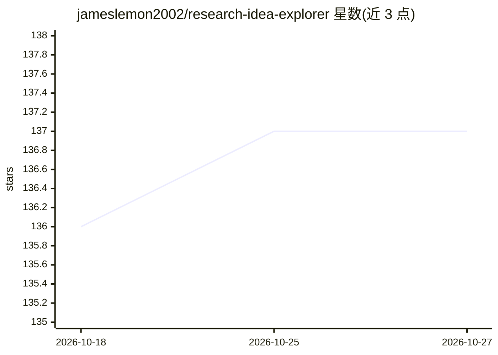

# jameslemon2002/research-idea-explorer

⭐ 137 · Python · MIT · 推送 2026-04-02 · [GitHub](https://github.com/jameslemon2002/research-idea-explorer) · 个人维护 · 中文 README

**文献驱动的研究选题探索工具：供 Codex CLI / Claude Code 生成研究 idea**

面向 Codex CLI 与 Claude Code 用户的研究想题 skill / command，以 Python 包形式提供（安装后得到 research-idea-explorer 与 rie 两个命令）。工作流为：先检索公开文献或读取本地文献库，生成 literature map 识别文献簇，再从多种 research moves 发散并收束为结构化 research cards，用持久化 JSON memory graph 记录 accept / reject 历史与用户偏好；支持 hybrid / lexical / embedding / graph 四种检索策略，默认按 topic scope 隔离记忆，需用户要求时才做第二轮 mutation。

## 筛选速览

| 维度 | 判定 | 备注 |
|---|---|---|
| AI 角色 | `ai-native` | 本体是模型或模型工具 |
| 许可风险 | `permissive` | MIT |
| 部署形态 | `library` | 以包/库形式分发 |
| 模型依赖 | — | README 未给出锁定关系 |
| 硬件要求 | — | 无带数字的原话,不猜 |
| 安装摩擦 | `low` | 无编译、无系统依赖或容器化 |
| 成熟度 | — | 结构信号不足 |

## 能力要点

- 文献先行：先做 literature map 再发散，输出 Title/Abstract/Design 等结构化 research cards
- 持久化 memory graph 记录 accept / reject 历史与对话偏好
- 支持 14 种文献源（OpenAlex/arXiv/Zotero/本地 JSON 等）
- 提供 Codex skill 与 Claude Code command 一键安装器

## 适用场景

- 围绕研究主题生成有文献依据的研究方向
- 追踪并延续已被接受的研究选题方向
- 把对 idea 的接受/拒绝判断沉淀下来供后续轮次使用

## 场景标签

`科研工具` `语义搜索` · 领域:知识与检索

## 证据(README 行号)

> L22: `Research Idea Explorer` 是给 `Codex CLI` 和 `Claude Code` 用的研究想题 skill / command。它把“先看文献、再发散、再筛选、再继续推进”做成了一条稳定工作流：
> L26: 3. 再从多种 research moves 发散，并收束成结构化 research cards
> L160: - 结构化 research cards：

## 星数曲线

2026-10-18 136 → 2026-10-27 137（+1）

---
*卡片 v1 · prompt 1.4 · 生成 2026-10-22 · 置信度 high · 依据 README sha `a7651d98b0c6` · [字段定义](../../DATASET.md)*
