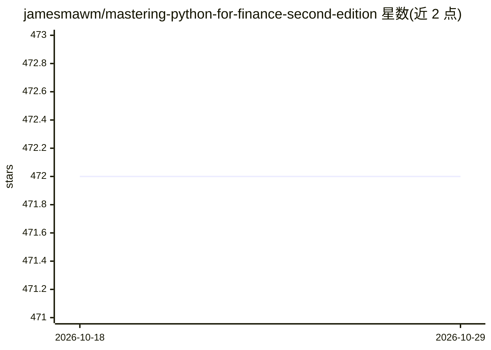

# jamesmawm/mastering-python-for-finance-second-edition

⭐ 472 · Jupyter Notebook · 推送 2026-02-03 · [GitHub](https://github.com/jamesmawm/mastering-python-for-finance-second-edition) · 个人维护

**《Mastering Python for Finance（第二版）》图书配套源码**

Packt 出版书籍的代码仓库，提供全书各章节示例源码，内容涵盖线性/非线性金融模型求解、DOW 指数主成分分析、平稳与非平稳时间序列的预测与预报、事件驱动回测工具及高频算法交易平台构建。2020 年 10 月更新说明指出部分市场指数已无法从 Alpha Vantage 下载，可改用 MSFT、GOOG 等个股代码替代，输出值可能与书中不同。各章要求 Python 3.7（第 11 章 3.6），支持 Windows/macOS/Linux。

## 筛选速览

| 维度 | 判定 | 备注 |
|---|---|---|
| AI 角色 | `ai-knowledge` | 知识聚合/清单类 |
| 许可风险 | `none` | — |
| 部署形态 | `None` |  |
| 模型依赖 | — | README 未给出锁定关系 |
| 硬件要求 | — | 无带数字的原话,不猜 |
| 安装摩擦 | `low` | 无编译、无系统依赖或容器化 |
| 成熟度 | — | 结构信号不足 |

## 能力要点

- 覆盖时间序列分析、回测与算法交易等章节示例代码
- 事件驱动回测工具与高频交易平台构建示例
- 含 Alpha Vantage 数据源失效的替代方案说明
- 支持 Python 3.7/3.6，跨 Windows/macOS/Linux

## 适用场景

- 跟随书籍章节运行书中金融计算示例
- 学习用 Python 做时间序列预测与回测
- 参考事件驱动回测与算法交易平台的实现代码

## 场景标签

`金融量化` `教程课程` · 领域:学习与行业

## 证据(README 行号)

> L3: This is the code repository for Mastering Python for Finance - Second Edition, published by Packt.
> L21: The second edition of Mastering Python for Finance will guide you through carrying out complex financial calculatio
> L24: * Solve linear and nonlinear models representing various financial problems

## 星数曲线

2026-10-18 472 → 2026-10-29 472（+0）

---
*卡片 v1 · prompt 1.4 · 生成 2026-10-21 · 置信度 high · 依据 README sha `3dd4cd860062` · [字段定义](../../DATASET.md)*
