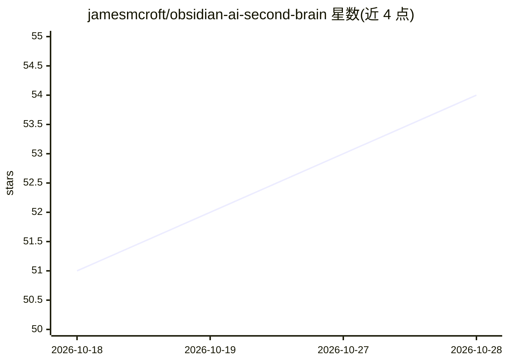

# jamesmcroft/obsidian-ai-second-brain

⭐ 54 · MIT · 推送 2026-04-01 · [GitHub](https://github.com/jamesmcroft/obsidian-ai-second-brain) · [官网](https://www.jamescroft.co.uk/why-your-second-brain-needs-an-ai-companion/) · 个人维护

**用 Obsidian 与 CODE/PARA 搭建 AI 增强第二大脑的启动模板**

作为博客系列的配套启动模板提供：一个按 PARA 方法组织的 Obsidian vault，包含模板笔记、四个互联示例笔记、CODE 工作流文档，以及以 markdown 指令集形式存储的 GitHub Copilot 技能，用于让 AI agent 执行笔记检索、去重、交叉链接等知识管理操作。设计约束是所有结构机器可读（类型化 frontmatter、可预测的章节布局），AI 通过遍历 wikilinks 构成的知识图谱参与组织与蒸馏。使用方式为 fork、clone 并作为 Obsidian vault 打开。

## 筛选速览

| 维度 | 判定 | 备注 |
|---|---|---|
| AI 角色 | `ai-knowledge` | 知识聚合/清单类 |
| 许可风险 | `permissive` | MIT |
| 部署形态 | `None` |  |
| 模型依赖 | — | README 未给出锁定关系 |
| 硬件要求 | — | 无带数字的原话,不猜 |
| 安装摩擦 | `low` | 无编译、无系统依赖或容器化 |
| 成熟度 | — | 结构信号不足 |

## 能力要点

- 按 PARA 组织的 Obsidian vault 模板与互联示例笔记
- 以 markdown 指令集形式存储的 AI 技能（含 vault-knowledge-retrieval）
- CODE 四阶段工作流中定义了各阶段的 AI 参与方式
- 结构约束为机器可读：类型化 frontmatter 与统一模板

## 适用场景

- 从零搭建带 AI 参与的个人知识管理系统
- 让 GitHub Copilot 按技能检索和整理我的 Obsidian 笔记
- 学习 CODE/PARA 方法在 AI 协作下的落地结构

## 场景标签

`知识库管理` · 领域:知识与检索

## 证据(README 行号)

> L3: A starter template for building an **AI-augmented Second Brain** using Obsidian, the CODE/PARA methodology, and GitH
> L27: Custom skills are detailed, reusable instruction sets stored as markdown that tell AI agents exactly how to perform
> L89: 6. **Try a skill**: ask GitHub Copilot "what do I know about {topic}?" to invoke the `vault-knowledge-retrieval` sk

## 星数曲线

2026-10-18 51 → 2026-10-28 54（+3）

---
*卡片 v1 · prompt 1.4 · 生成 2026-10-24 · 置信度 mid · 依据 README sha `e21625fa33fc` · [字段定义](../../DATASET.md)*
