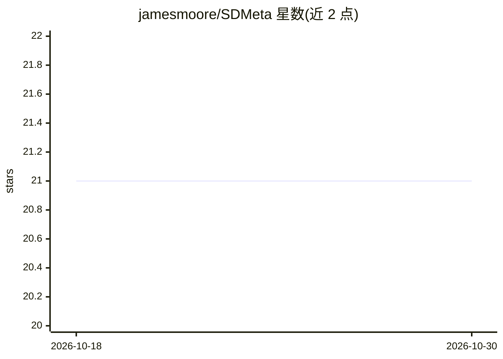

# jamesmoore/SDMeta

⭐ 21 · C# · MIT · 推送 2026-10-29 · [GitHub](https://github.com/jamesmoore/SDMeta) · 个人维护

**批量提取并检索 Stable Diffusion 生成图片元数据的工具**

读取 ComfyUI 与 Automatic1111/Stable Diffusion 生成的图片文件，批量抽取其中嵌入的元数据（含提示词），存入 SQLite 数据库缓存，并提供 Web UI 供浏览、检索提示词与生成缩略图。面向 SD 用户整理本地生成产物。图片文件仅读取不修改（除非通过 UI 删除），Docker 部署需挂载数据库/缩略图与图片两个目录，Web 服务默认运行在 8080 端口，Windows 另提供可执行文件。

## 筛选速览

| 维度 | 判定 | 备注 |
|---|---|---|
| AI 角色 | `ai-ecosystem` | LLM/agent 周边工具 |
| 许可风险 | `permissive` | MIT |
| 部署形态 | `desktop` | 安装包/桌面程序 |
| 模型依赖 | — | README 未给出锁定关系 |
| 硬件要求 | — | 无带数字的原话,不猜 |
| 安装摩擦 | `low` | 无编译、无系统依赖或容器化 |
| 成熟度 | — | 结构信号不足 |

## 能力要点

- 批量提取 ComfyUI 与 Automatic1111 生成文件的元数据
- Web UI 浏览与搜索提示词
- SQLite 缓存元数据并生成缩略图
- 图片目录可只读挂载，源文件不被修改

## 适用场景

- 整理大量 SD 生成图片并找回当时的提示词
- 按提示词关键词搜索历史生成结果
- 在 Docker 中长期维护本地生成图库的元数据索引

## 场景标签

 · 领域:AI 生成内容管理工具

## 证据(README 行号)

> L3: * Bulk extract metadata from files generated by ComfyUI and Automatic1111/Stable Diffusion.
> L4: * View and search in a web UI.

## 星数曲线

2026-10-18 21 → 2026-10-30 21（+0）

---
*卡片 v1 · prompt 1.4 · 生成 2026-10-28 · 置信度 high · 依据 README sha `6f0f6f0fa1dc` · [字段定义](../../DATASET.md)*
