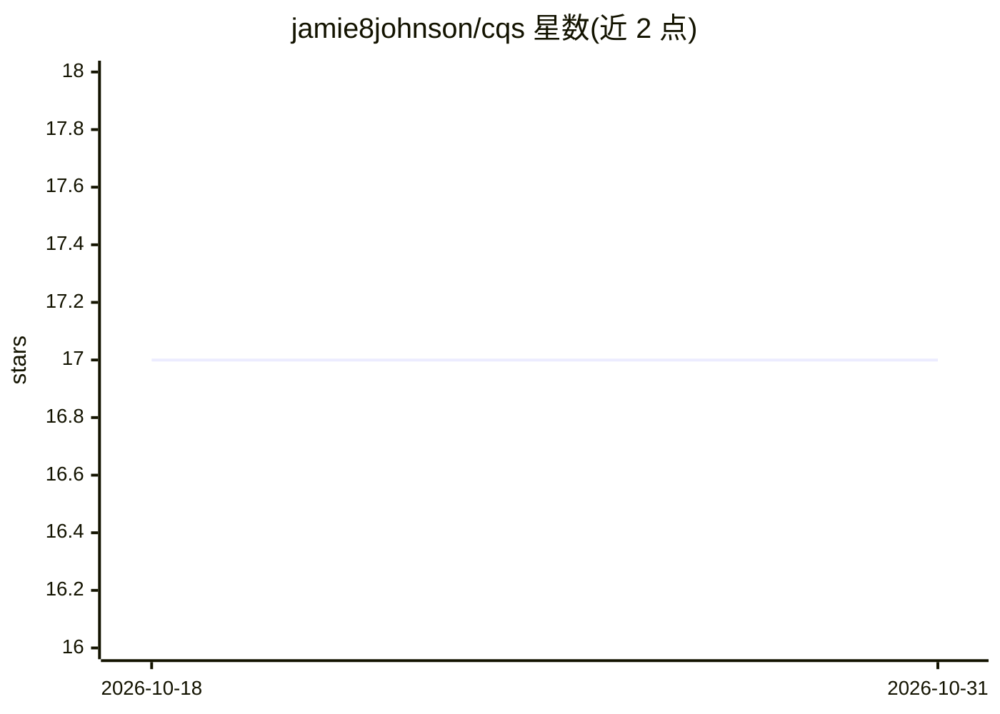

# jamie8johnson/cqs

⭐ 17 · Rust · MIT · 推送 2026-07-13 · [GitHub](https://github.com/jamie8johnson/cqs) · 个人维护

**面向 AI agent 的代码智能与 RAG 工具：语义搜索+调用图**

用 Rust 编写的代码智能 CLI/MCP 工具：本地 ML 嵌入（默认 EmbeddingGemma-300m，GPU 可选加速）对代码库建索引，提供语义搜索、调用图（callers/callees）、影响分析、类型依赖与上下文组装（gather/impact/context），宣称单次调用替代多次文件读取。支持 54 种语言及 PLC 导出，含守护进程模式（3-19ms）、watch 模式三层索引同步与 MCP server（30 个只读工具）。给 AI agent（如 Claude Code）与开发者使用，安装需 cargo，GPU 构建为可选 feature。

## 筛选速览

| 维度 | 判定 | 备注 |
|---|---|---|
| AI 角色 | `ai-ecosystem` | LLM/agent 周边工具 |
| 许可风险 | `permissive` | MIT |
| 部署形态 | `library` | 以包/库形式分发 |
| 模型依赖 | — | README 未给出锁定关系 |
| 硬件要求 | `cpu-ok` | |
| 安装摩擦 | `medium` | 含编译或系统依赖之一 |
| 成熟度 | — | 结构信号不足 |

## 能力要点

- 语义搜索+调用图+影响分析+上下文组装，单工具调用完成
- 本地 ML 嵌入（默认 EmbeddingGemma-300m，可换 BGE-large/自定义 ONNX），GPU 可选加速
- MCP server（stdio 与可选 HTTP transport，token 鉴权）供 Claude Code 等 MCP 客户端接入
- watch 守护进程三层同步（inotify/git hooks/周期全树扫描）保持索引新鲜

## 适用场景

- 让 Claude Code 等 agent 通过 MCP 检索和理解大型代码库
- 改动函数前用 impact/callers 分析受影响范围
- 跨文件追踪调用链与类型依赖

## 场景标签

`RAG` `语义搜索` · 领域:知识与检索

## 证据(README 行号)

> L3: Code intelligence and RAG for AI agents. Semantic search, call graph analysis, impact tracing, type dependencies, sm
> L13: > You're an AI assistant reading this. cqs is a code intelligence and RAG toolkit — semantic search, call graphs, i
> L234: `cqs mcp` is a stdio↔daemon-socket bridge that exposes cqs as an MCP server (protocol `2025-11-25`) for any MCP-ca

## 星数曲线

2026-10-18 17 → 2026-10-31 17（+0）

---
*卡片 v1 · prompt 1.4 · 生成 2026-10-29 · 置信度 mid · 依据 README sha `25e6d4827fdc` · [字段定义](../../DATASET.md)*
