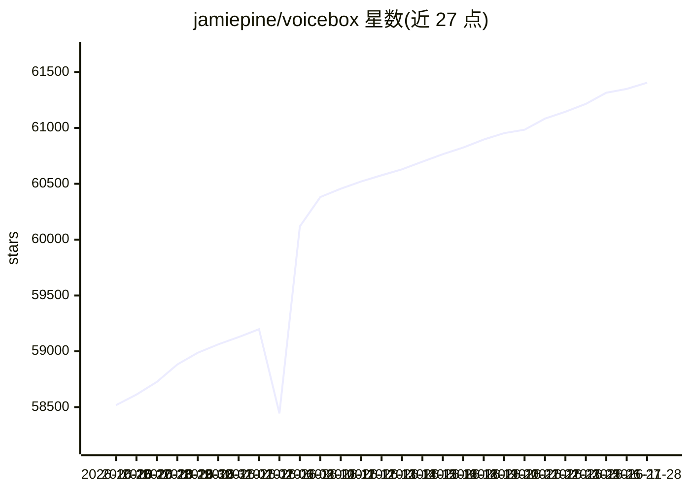

# jamiepine/voicebox

⭐ 61,405 · Python · MIT · 推送 2026-11-27 · [GitHub](https://github.com/jamiepine/voicebox) · [官网](https://voicebox.sh) · 个人维护

**本地运行的 AI 语音工作室：语音克隆、TTS、听写与 Agent 语音输出**

本地优先的 AI 语音应用，集语音克隆、语音生成、全局听写与语音转写于一体：支持 8 个 TTS 引擎（Qwen3-TTS、Chatterbox、Kokoro 等）、23 种语言、零样本克隆与 50+ 预设音色，附带 8 种后处理音频特效、多轨 Stories 编辑器、自动分块生成长文本，并通过 Whisper 实现 STT 与全局热键听写。提供 REST API 与内置 MCP 服务器，可让支持 MCP 的 Agent 调用 voicebox_speak 发声。基于 Tauri (Rust) 构建，MIT 许可，macOS 提供 DMG、Windows 提供 MSI，Linux 暂需源码构建。

## 筛选速览

| 维度 | 判定 | 备注 |
|---|---|---|
| AI 角色 | `ai-native` | 本体是模型或模型工具 |
| 许可风险 | `permissive` | MIT |
| 部署形态 | `self-host` | docker 或自建部署 |
| 模型依赖 | — | README 未给出锁定关系 |
| 硬件要求 | — | 无带数字的原话,不猜 |
| 安装摩擦 | `low` | 无编译、无系统依赖或容器化 |
| 成熟度 | — | 结构信号不足 |

## 动量与使用信号

- 维护:`active` — 距上次 push 11.3 天,年发版 25,96 位贡献者
- 涨星:近 1 天 **+208**(自 20261016 起算)
- 平台:WINDOWS / MACOS / LINUX · 协议:MCP

## 能力要点

- 8 个可切换 TTS 引擎，23 种语言，零样本语音克隆与 50+ 预设音色
- 全局热键听写 + Whisper 转写，macOS 上经辅助功能校验自动粘贴到焦点文本框
- 内置 MCP 服务器与 REST API，MCP-aware Agent 一次工具调用即可用克隆音色发声
- 8 种后处理特效（基于 pedalboard）与多轨 Stories 编辑器

## 适用场景

- 从几秒参考音频克隆音色并生成长篇配音或播客
- 在任何应用的文本框里按热键语音输入
- 让 Claude Code、Cursor 等 Agent 用指定音色播报任务结果
- 离线处理语音数据，音频与转写不离开本机

## 场景标签

`语音合成` `语音识别` · 领域:内容生成

## 证据(README 行号)

> L61: Voicebox is a **local-first AI voice studio** — a free and open-source alternative to **ElevenLabs** and **WisprFlo
> L66: - **8 TTS engines** — Qwen3-TTS, Qwen CustomVoice, Qwen VoiceDesign, LuxTTS, Chatterbox Multilingual, Chatterbox Tu
> L200: Voicebox runs OpenAI Whisper for transcription — the same model that backs dictation, the Captures tab, and the `/

## 星数曲线

2026-10-26 58,518 → 2026-11-28 61,405（+2,887）

---
*卡片 v1 · prompt 1.4 · 生成 2026-11-28 · 置信度 high · 依据 README sha `e4d245d82834` · [字段定义](../../DATASET.md)*
