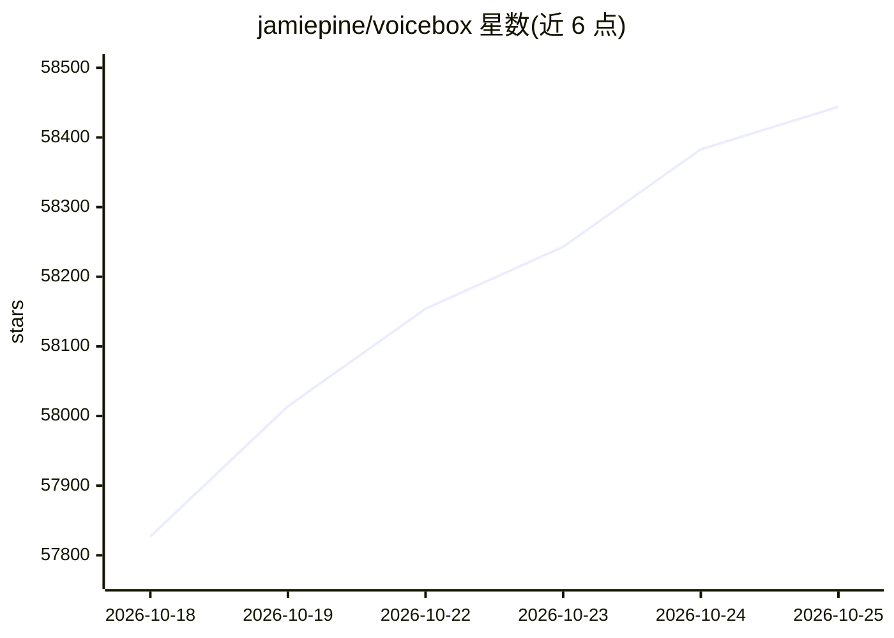

# jamiepine/voicebox

⭐ 58,444 · Python · MIT · 推送 2026-10-07 · [GitHub](https://github.com/jamiepine/voicebox) · [官网](https://voicebox.sh) · 个人维护

**本地优先的 AI 语音工作室：克隆声音、生成语音、全局听写**

本地优先的开源语音应用，整合语音输入与输出两个环节：从几秒参考音频做零样本克隆，支持 8 个 TTS 引擎与 23 种语言生成语音，通过全局热键做听写并以 Whisper 转写，还可经内置 MCP 服务器让 MCP 感知的 agent 以克隆声音发声。附带后期音效处理、多轨 Stories 编辑器、生成版本管理与 REST API。模型与音频数据全程留在本机。基于 Tauri (Rust) 构建，macOS/Windows 提供安装包，Linux 需从源码构建。

## 筛选速览

| 维度 | 判定 | 备注 |
|---|---|---|
| AI 角色 | `ai-native` | 本体是模型或模型工具 |
| 许可风险 | `permissive` | MIT |
| 部署形态 | `self-host` | docker 或自建部署 |
| 模型依赖 | — | README 未给出锁定关系 |
| 硬件要求 | — | 无带数字的原话,不猜 |
| 安装摩擦 | `low` | 无编译、无系统依赖或容器化 |
| 成熟度 | — | 结构信号不足 |

## 动量与使用信号

- 维护:`active` — 距上次 push 11.3 天,年发版 25,96 位贡献者
- 涨星:近 1 天 **+208**(自 20261016 起算)
- 平台:WINDOWS / MACOS / LINUX · 协议:MCP

## 能力要点

- 8 个可切换的 TTS 引擎（Qwen3-TTS、Chatterbox、Kokoro 等）与 23 种语言
- 零样本声音克隆与 50+ 预置声音
- 全局热键听写 + Whisper 语音转写，支持 LLM 清理口头语
- 内置 MCP 服务器与 REST API，agent 可通过 voicebox_speak 发声

## 适用场景

- 从几秒参考音频克隆声音并批量生成长文本语音
- 系统级全局热键听写输入到任意应用
- 给 Claude Code/Cursor 等 agent 配上克隆声音输出
- 制作多角色对话、播客与叙事音频

## 场景标签

`语音合成` `语音识别` · 领域:内容生成

## 证据(README 行号)

> L61: Voicebox is a **local-first AI voice studio** — a free and open-source alternative to **ElevenLabs** and **WisprFlo
> L74: - **Agent voice output** — one tool call (`voicebox_speak`) and any MCP-aware agent (Claude Code, Cursor, Cline) sp
> L78: - **Runs everywhere** — macOS (MLX/Metal), Windows (CUDA), Linux, AMD ROCm, Intel Arc, Docker

## 星数曲线

2026-10-18 57,827 → 2026-10-25 58,444（+617）

---
*卡片 v1 · prompt 1.4 · 生成 2026-10-18 · 置信度 high · 依据 README sha `4bf565df6b84` · [字段定义](../../DATASET.md)*
