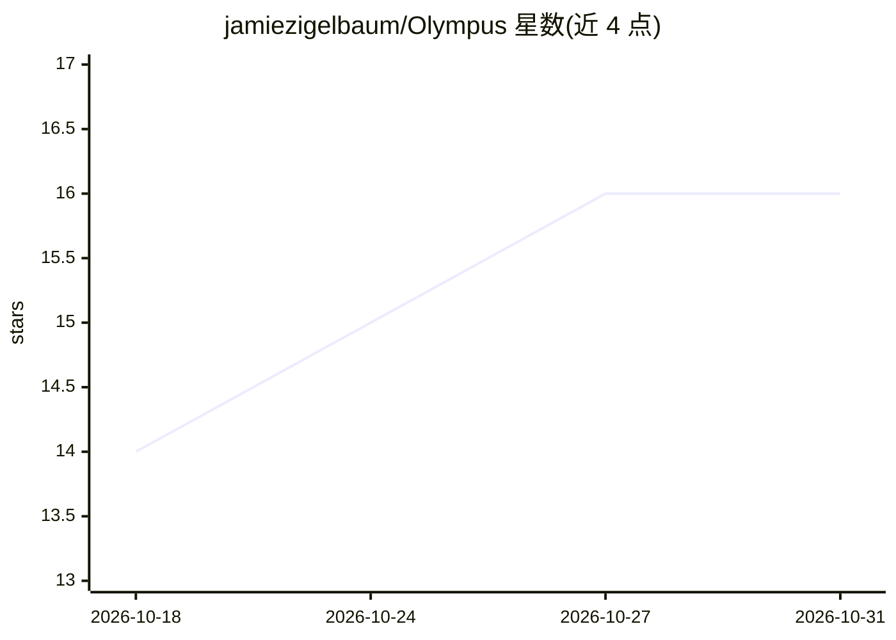

# jamiezigelbaum/Olympus

⭐ 16 · TypeScript · MIT · 推送 2026-10-30 · [GitHub](https://github.com/jamiezigelbaum/Olympus) · [官网](https://olympusplugin.ai) · 个人维护

**本地优先的个人知识库：让 AI 应用安全引用你的私密数据**

运行在 Mac（Apple silicon）与 Omarchy Linux 上的本地个人数据引擎：索引 Dropbox、Gmail、Google Drive 与本地文件夹，通过 MCP 协议接入 ChatGPT、Claude、Grok、Claude Code 等应用。核心机制是三级隐私分层（Personal/Private/Secret）：Personal 内容可被外部 AI 引用作答，Private 仅由本机内置模型（Qwen3.5 2B/4B）在本地作答并经密封面板展示，Secret 永不外发。索引与分类在本机完成，厂商仅运行不存储内容的转发 relay。限制：Intel Mac、其他 Linux 与 ARM Linux 暂不支持；自动标签可能有误。

## 筛选速览

| 维度 | 判定 | 备注 |
|---|---|---|
| AI 角色 | `ai-ecosystem` | LLM/agent 周边工具 |
| 许可风险 | `permissive` | MIT |
| 部署形态 | `None` |  |
| 模型依赖 | locked-api |  |
| 硬件要求 | — | 无带数字的原话,不猜 |
| 安装摩擦 | `medium` | 含编译或系统依赖之一 |
| 成熟度 | — | 结构信号不足 |

## 能力要点

- 三级隐私分层：Personal/Private/Secret，Secret 永不发送或作答
- 本机内置 Qwen3.5 私有模型（2B/4B）生成密封的私密回答
- 支持任意 MCP 应用，含 ChatGPT/Claude/Grok/Claude Code/Codex
- 安装器校验 SHA-256，LaunchAgent/systemd 后台运行，可一键修复更新

## 适用场景

- 让 ChatGPT/Claude 引用自己的邮件、文件并给出带引用的回答
- 健康、财务等私密事项仅在本机作答，不外发给云端模型
- 密码、恢复码等 Secret 内容自动识别并隔离于所有模型之外

## 场景标签

`RAG` `知识库管理` · 领域:知识与检索

## 证据(README 行号)

> L7: *A private second brain on your own computer, for ChatGPT, Claude, Grok and any AI app that speaks MCP. On a Mac, an
> L35: Every email, file and message is judged, one by one, as **Personal**,
> L50: Everything is stored and searched on your computer: the search index is built

## 星数曲线

2026-10-18 14 → 2026-10-31 16（+2）

---
*卡片 v1 · prompt 1.4 · 生成 2026-10-30 · 置信度 high · 依据 README sha `a8f5ceb5e198` · [字段定义](../../DATASET.md)*
