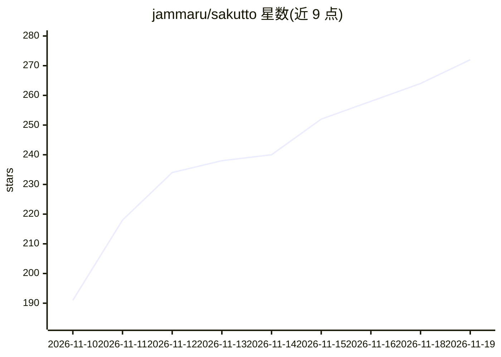

# jammaru/sakutto

⭐ 272 · TypeScript · MIT · 推送 2026-11-18 · [GitHub](https://github.com/jammaru/sakutto) · [官网](https://chrome.google.com/webstore/detail/mhlbjjijfkoghmcjndgdimhdlfkhadfl) · 个人维护

**本地运行 PLaMo 模型的浏览器翻译扩展，页面/PDF/视频/输入文本**

面向普通用户的 Chrome/Firefox 浏览器扩展，在设备本地完成网页、选中文本、PDF、视频字幕与输入文本的翻译。默认引擎为 PLaMo 3 Translate，通过固定的 wllama 构建在 WebGPU 或 CPU 上运行，支持 53 种语言，无账号、无遥测。PDF 翻译保留双栏/表格等版式；支持全局与按站点的术语表（CSV 导入导出）及“やさしい日本語”目标语。模型（0.8B Q4_K_M，约 546MB）首次使用时从 Hugging Face 下载并做 SHA-256 校验，之后离线可用。实验性选项可指向本机 OpenAI 兼容服务器（如 LM Studio、llama-server）。从两浏览器商店安装。

## 筛选速览

| 维度 | 判定 | 备注 |
|---|---|---|
| AI 角色 | `ai-native` | 本体是模型或模型工具 |
| 许可风险 | `permissive` | MIT |
| 部署形态 | `library` | 以包/库形式分发 |
| 模型依赖 | — | README 未给出锁定关系 |
| 硬件要求 | — | 无带数字的原话,不猜 |
| 安装摩擦 | `low` | 无编译、无系统依赖或容器化 |
| 成熟度 | `idea` | |

## 能力要点

- PLaMo 3 Translate 经 wllama 在 WebGPU/CPU 本地运行，无需服务器与账号
- 整页/选区/PDF（版式保留）/视频字幕/输入框翻译
- 全局与按站点术语表，单列表最多 5,000 词、单次运行可合并 10,000 词
- 实验性支持本机 OpenAI 兼容服务器（mlx_lm.server / LM Studio / llama-server）

## 适用场景

- 浏览外文网页或阅读英文/日文 PDF 论文时本地翻译，不上传文本
- 看 YouTube/X 视频时翻译字幕叠加
- 在输入框写作时用快捷键获得实时翻译预览
- 日语学习者把普通日文转为やさしい日本語

## 场景标签

 · 领域:浏览器/翻译工具

## 证据(README 行号)

> L16: Sakutto is an unofficial Chrome and Firefox extension that translates web pages, PDFs, video captions, selections, 
> L24: - **Local-first by default.** Page text, selections, your glossary, and translations stay on your device. There is 

## 星数曲线

2026-11-10 191 → 2026-11-19 272（+81）

---
*卡片 v1 · prompt 1.4 · 生成 2026-11-17 · 置信度 mid · 依据 README sha `a9296912c965` · [字段定义](../../DATASET.md)*
