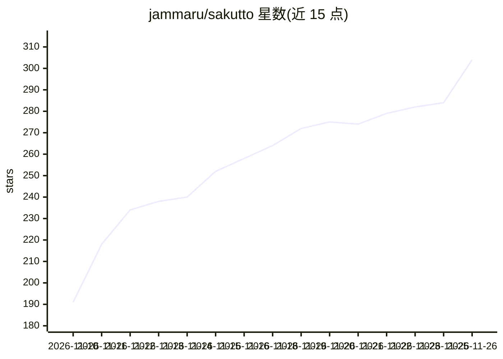

# jammaru/sakutto

⭐ 304 · TypeScript · MIT · 推送 2026-11-24 · [GitHub](https://github.com/jammaru/sakutto) · [官网](https://chrome.google.com/webstore/detail/mhlbjjijfkoghmcjndgdimhdlfkhadfl) · 个人维护

**浏览器本地翻译扩展：用 PLaMo 在设备上翻译网页/PDF/字幕**

非官方的 Chrome/Firefox 扩展，默认引擎为 PLaMo 3 Translate，通过固定版本的 wllama 构建在 WebGPU 或 CPU 上运行，模型权重约 546 MB 首次从 Hugging Face 下载后离线使用。功能覆盖整页翻译、划词弹窗、输入框即时替换、自有阅读器中的版式保留 PDF 翻译、YouTube/X 视频字幕覆盖层，以及全局与按站点的术语表（CSV 导入导出）和 Easy Japanese 目标语言。无账号、无遥测；Chrome 上另有 11 种 PLaMo 不支持的目标语言交给 Chrome 内置翻译器。

## 筛选速览

| 维度 | 判定 | 备注 |
|---|---|---|
| AI 角色 | `ai-native` | 本体是模型或模型工具 |
| 许可风险 | `permissive` | MIT |
| 部署形态 | `library` | 以包/库形式分发 |
| 模型依赖 | — | README 未给出锁定关系 |
| 硬件要求 | — | 无带数字的原话,不猜 |
| 安装摩擦 | `low` | 无编译、无系统依赖或容器化 |
| 成熟度 | — | 结构信号不足 |

## 能力要点

- 默认引擎 PLaMo 3 Translate 经 wllama 在设备上运行，支持 53 种语言双向翻译
- 版式保留的 PDF 逐页翻译（双栏、表格、图注结构保持）
- 全局与按站点术语表，单表至 5,000 词、单次合并至 10,000 词
- 实验性接入本地 OpenAI 兼容服务器（mlx_lm.server/LM Studio/llama-server 类）

## 适用场景

- 在浏览器中离线翻译整页网页并保留原文布局
- 将英文学术 PDF 或日文文档逐页翻译且保持排版
- 观看 YouTube/X 视频时实时翻译字幕
- 维护术语表使产品名与专业词汇按自己的译法输出

## 场景标签

 · 领域:浏览器工具/机器翻译

## 证据(README 行号)

> L16: Sakutto is an unofficial Chrome and Firefox extension that translates web pages, PDFs, video captions, selections, 
> L118: No, not by default. Translation runs on your device, and the developer receives no page text, selections, glossary

## 星数曲线

2026-11-10 191 → 2026-11-26 304（+113）

---
*卡片 v1 · prompt 1.4 · 生成 2026-11-25 · 置信度 high · 依据 README sha `354e7a492372` · [字段定义](../../DATASET.md)*
