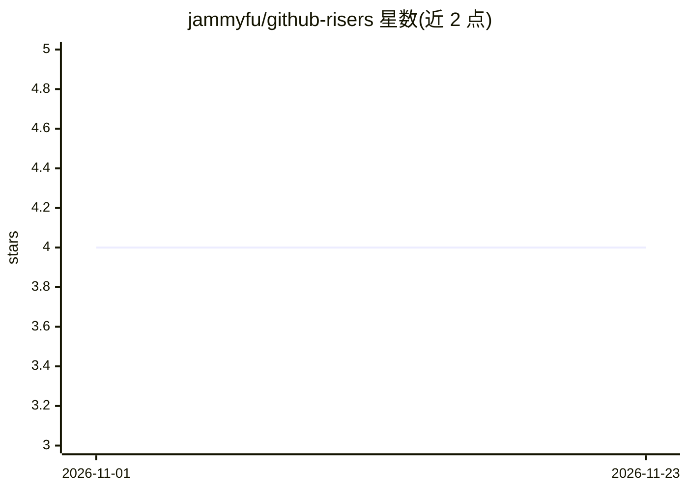

# jammyfu/github-risers

⭐ 4 · Python · MIT · 推送 2026-11-22 · [GitHub](https://github.com/jammyfu/github-risers) · [官网](https://jammyfu.github.io/github-risers/) · 个人维护 · 中文 README

**按每日新增 star 排名的 GitHub 上升项目每日榜单**

由脚本基于 GitHub API 自动生成的开源排行榜，以最近 7/30/365 个完整 UTC 天的 star 增量除以天数排序，而非总 star 数。AI 为主榜单，另设开发工具、安全、Web、基础设施、设计、数据六个类别；每日更新并归档历史快照，规则公开，提供五种语言版本。用户可通过在线网站直接查看（无需安装），或编辑 data/projects.json 提交 PR 添加追踪项目；本榜单每板展示前 10，完整前 20 在 latest/rankings.md。

## 筛选速览

| 维度 | 判定 | 备注 |
|---|---|---|
| AI 角色 | `ai-knowledge` | 知识聚合/清单类 |
| 许可风险 | `permissive` | MIT |
| 部署形态 | `None` |  |
| 模型依赖 | — | README 未给出锁定关系 |
| 硬件要求 | — | 无带数字的原话,不猜 |
| 安装摩擦 | `low` | 无编译、无系统依赖或容器化 |
| 成熟度 | — | 结构信号不足 |

## 能力要点

- 按 star 增量/天排名，所有数字来自 GitHub API
- AI 主榜单加六个类别，每日更新并归档每次运行
- 五语言 README，排名规则公开
- 通过编辑 data/projects.json 并提 PR 添加追踪项目

## 适用场景

- 查找近期 star 增长快的 AI 与开发者工具项目
- 查看某仓库在 7/30/365 天窗口的上升曲线
- 通过提 PR 让自己关注的项目进入追踪清单

## 场景标签

`精选清单` · 领域:学习与行业

## 证据(README 行号)

> L43: A leaderboard of GitHub repos ranked by stars gained per day, not total stars. AI is the main board; six more categ
> L55: Stars gained in the last 7, 30 or 365 complete UTC days, divided by those days. All numbers come from the GitHub AP
> L59: Read the boards below, or the full top 20 in latest/. To add a tracked project, edit data/projects.json (five langu

## 星数曲线

2026-11-01 4 → 2026-11-23 4（+0）

---
*卡片 v1 · prompt 1.4 · 生成 2026-11-21 · 置信度 high · 依据 README sha `81d1a1407d3d` · [字段定义](../../DATASET.md)*
