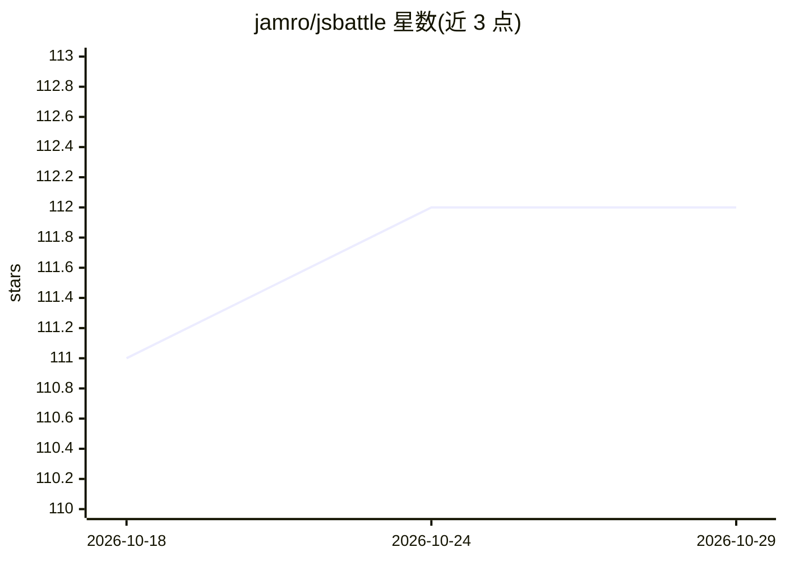

# jamro/jsbattle

⭐ 112 · JavaScript · MIT · 推送 2026-03-30 · [GitHub](https://github.com/jamro/jsbattle) · [官网](http://jsbattle.jmrlab.com) · 个人维护

**用 JavaScript 编写坦克 AI 并对战的游戏平台**

受 Robocode 启发的编程游戏：玩家用 JavaScript 编写坦克的作战 AI，坦克在竞技场中交战，目标是击败所有对手。本体提供对战仿真与运行环境，AI 逻辑由玩家代码提供。采用 lerna 管理的多包 monorepo 结构，文档位于 /packages/jsbattle 及官网 jsbattle.jmrlab.com/docs，通过 npm 分发。README 较简短，细节需查阅文档。

## 筛选速览

| 维度 | 判定 | 备注 |
|---|---|---|
| AI 角色 | `ai-ecosystem` | LLM/agent 周边工具 |
| 许可风险 | `permissive` | MIT |
| 部署形态 | `None` |  |
| 模型依赖 | — | README 未给出锁定关系 |
| 硬件要求 | — | 无带数字的原话,不猜 |
| 安装摩擦 | `low` | 无编译、无系统依赖或容器化 |
| 成熟度 | — | 结构信号不足 |

## 能力要点

- 玩家以 JavaScript 编写坦克的作战 AI
- 竞技场对战仿真，击败全部对手获胜
- lerna 管理的多包结构，npm 分发

## 适用场景

- 通过编写坦克 AI 练习 JavaScript 编程
- 组织或参与编程对战竞赛
- 以游戏方式学习 AI 决策逻辑设计

## 场景标签

 · 领域:游戏/编程教育

## 证据(README 行号)

> L11: JsBattle is inspired by Robocode. It is a game for JavaScript developers. The goal is to program artificial intelli

## 星数曲线

2026-10-18 111 → 2026-10-29 112（+1）

---
*卡片 v1 · prompt 1.4 · 生成 2026-10-23 · 置信度 mid · 依据 README sha `51e49d9701d9` · [字段定义](../../DATASET.md)*
