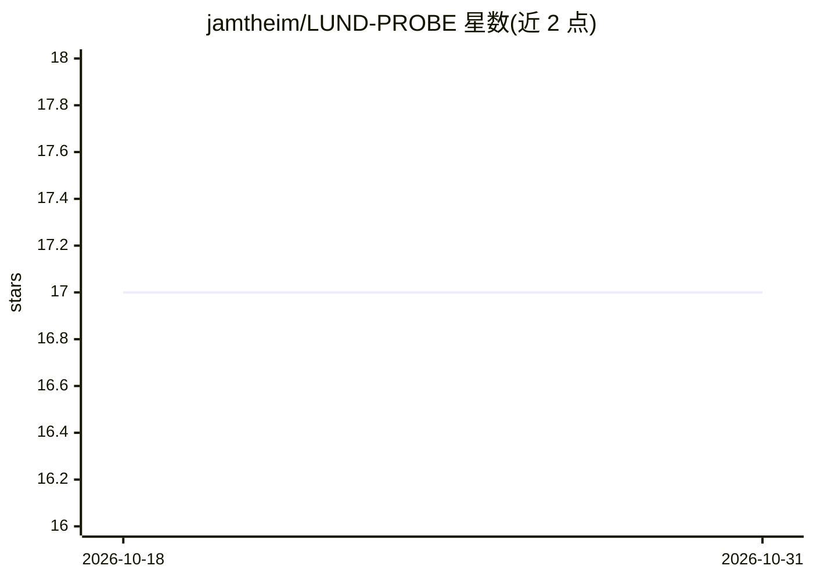

# jamtheim/LUND-PROBE

⭐ 17 · Python · 推送 2026-03-20 · [GitHub](https://github.com/jamtheim/LUND-PROBE) · [官网](https://datahub.aida.scilifelab.se/10.23698/aida/lund-probe) · 组织维护

**前列腺癌 MRI 放疗开放基准数据集（432 例）及加载可视化 notebook**

LUND-PROBE 是面向 MRI 基放疗计划研究的数据集：432 例前列腺癌患者的临床 MRI、合成 CT（sCT）、靶区与危及器官分割、剂量分布，均为 3D NIfTI 格式；扩展部分含 35 例，附深度学习生成的分割、分割不确定性图及四位放射肿瘤医师的手工修正分割。仓库本身提供 Python notebook，用 SimpleITK 读取数据并用内置函数可视化（分割叠加、剂量叠加、配准 sCT 显示、重采样等）。数据经 AIDA Data Hub 申请获取，配套论文发表于 Scientific Data。

## 筛选速览

| 维度 | 判定 | 备注 |
|---|---|---|
| AI 角色 | `ai-knowledge` | 知识聚合/清单类 |
| 许可风险 | `none` | — |
| 部署形态 | `None` |  |
| 模型依赖 | — | README 未给出锁定关系 |
| 硬件要求 | — | 无带数字的原话,不猜 |
| 安装摩擦 | `low` | 无编译、无系统依赖或容器化 |
| 成熟度 | — | 结构信号不足 |

## 能力要点

- 432 例 MRI/sCT/分割/剂量数据，3D NIfTI 格式
- 35 例扩展子集含 DL 分割、不确定性图与 4 位医师手工修正
- 提供 SimpleITK 加载与叠加可视化、重采样的示例 notebook

## 适用场景

- 获取前列腺 MRI-only 放疗的公开基准数据
- 研究 DL 分割与医师勾画的差异及不确定性
- 复用 notebook 做分割/剂量可视化分析

## 场景标签

 · 领域:医学影像/放射治疗

## 证据(README 行号)

> L4: <small>LUND-PROBE is a dataset, comprising clinical MRI- and synthetic CT (sCT) images in 3D NIfTI format, target an
> L6: <small>This notebook provides sample code for loading and visualizing the LUND-PROBE data. Follow along and feel fre

## 星数曲线

2026-10-18 17 → 2026-10-31 17（+0）

---
*卡片 v1 · prompt 1.4 · 生成 2026-10-29 · 置信度 high · 依据 README sha `515adc7b5ba3` · [字段定义](../../DATASET.md)*
