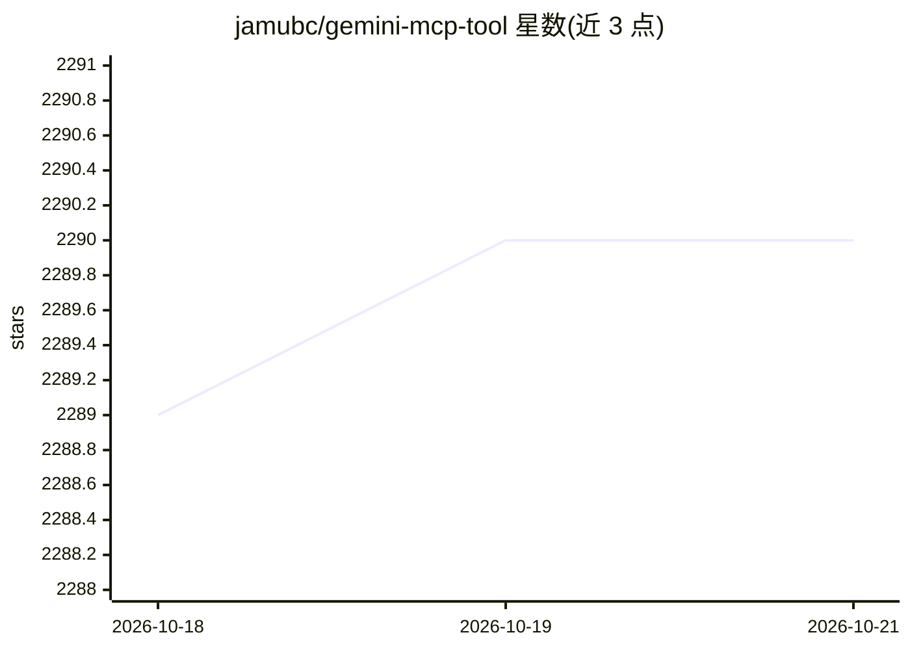

# jamubc/gemini-mcp-tool

⭐ 2,290 · TypeScript · NOASSERTION · 推送 2026-07-21 · [GitHub](https://github.com/jamubc/gemini-mcp-tool) · [官网](https://jamubc.github.io/gemini-mcp-tool/) · 个人维护

**让 AI 助手通过 MCP 调用 Gemini/Antigravity CLI 的服务器**

Model Context Protocol 服务器，使 Claude 等 AI 助手可调用 Gemini CLI（现已默认其后继 Antigravity CLI `agy`）进行大文件与代码库分析，支持 `@` 文件引用语法、可选 Gemini 模型与沙箱模式。提供 ask-gemini、sandbox-test、Ping、Help 四个 AI 工具，及 /analyze、/sandbox 等斜杠命令（其他客户端兼容性未测试）。要求 Node.js v16+ 与 Gemini/Antigravity CLI 已安装配置。`agy` 后端为实验状态：print 模式仅支持 Gemini 3.5 Flash，工具执行不在沙箱内。可通过 npx 一行接入 Claude Code。

## 筛选速览

| 维度 | 判定 | 备注 |
|---|---|---|
| AI 角色 | `ai-ecosystem` | LLM/agent 周边工具 |
| 许可风险 | `permissive` | NOASSERTION |
| 部署形态 | `library` | 以包/库形式分发 |
| 模型依赖 | — | README 未给出锁定关系 |
| 硬件要求 | — | 无带数字的原话,不猜 |
| 安装摩擦 | `low` | 无编译、无系统依赖或容器化 |
| 成熟度 | `idea` | |

## 能力要点

- MCP 服务器暴露 ask-gemini/sandbox-test 等工具给 AI 助手
- 支持 `@` 文件/目录引用语法与大代码库分析
- 2026-06-18 起自动切换到 Antigravity CLI 后端（可通过环境变量保留 gemini）
- 提供沙箱模式安全执行代码

## 适用场景

- 在 Claude Code 中借助 Gemini 的大 token 窗口分析大文件或整个代码库
- 让 AI 助手在沙箱中安全测试脚本与代码变更
- 跨模型提问：通过 Claude 向 Gemini 咨询问题

## 场景标签

`模型网关` · 领域:Agent 开发

## 证据(README 行号)

> L11: This is a simple Model Context Protocol (MCP) server that allows AI assistants to interact with the Gemini CLI. It 
> L25:  🚀 Important: Gemini CLI is retired. This tool now defaults to Antigravity CLI (`agy`)

## 星数曲线

2026-10-18 2,289 → 2026-10-21 2,290（+1）

---
*卡片 v1 · prompt 1.4 · 生成 2026-10-21 · 置信度 high · 依据 README sha `bc33d0defa60` · [字段定义](../../DATASET.md)*
