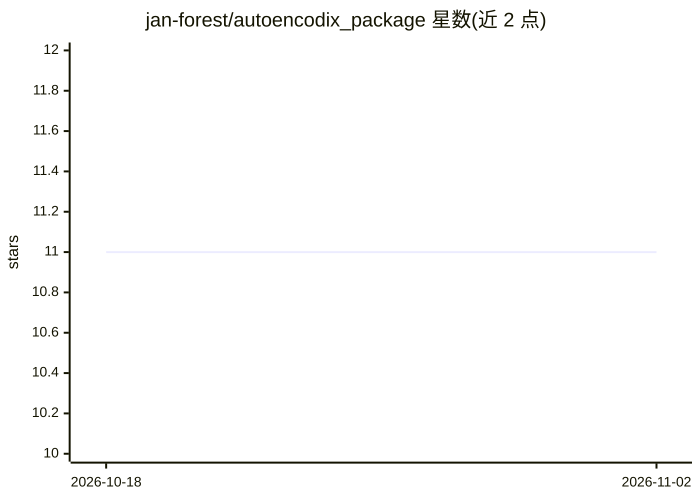

# jan-forest/autoencodix_package

⭐ 11 · Jupyter Notebook · NOASSERTION · 推送 2026-10-30 · [GitHub](https://github.com/jan-forest/autoencodix_package) · [官网](https://jan-forest.github.io/autoencodix_package/) · 组织维护

**生物多组学数据自编码器训练与评估 Python 框架**

提供覆盖自编码器应用全流程的统一 Python 包：以编码器-解码器结构对非线性、多模态数据进行降维与嵌入，面向大规模组学测量等生物数据。包含多种架构（Vanillix、Varix、Ontix 等），通过 DataPackage 与 Config 组装流水线，支持确定性训练（FIX_RANDOMNESS）、可视化与自定义，并为每个流水线提供教程。要求 Python>=3.9 <3.13，推荐 uv 管理，有 Nature Computational Science 前序发表。

## 筛选速览

| 维度 | 判定 | 备注 |
|---|---|---|
| AI 角色 | `ai-native` | 本体是模型或模型工具 |
| 许可风险 | `none` | NOASSERTION |
| 部署形态 | `library` | 以包/库形式分发 |
| 模型依赖 | — | README 未给出锁定关系 |
| 硬件要求 | — | 无带数字的原话,不猜 |
| 安装摩擦 | `medium` | 含编译或系统依赖之一 |
| 成熟度 | — | 结构信号不足 |

## 能力要点

- 统一实现自编码器训练-评估全流程
- 多种架构（Vanillix/Varix/Ontix 等）覆盖多类应用
- FIX_RANDOMNESS 确定性训练选项
- 按流水线提供教程与文档

## 适用场景

- 对多组学生物数据做非线性降维与表示学习
- 用统一框架训练和评估不同自编码器架构
- 多模态组学数据整合嵌入

## 场景标签

 · 领域:生物信息学/表示学习

## 证据(README 行号)

> L2: Autoencoders are deep-learning-based networks for dimension reduction and embedding by a combination of a compressin
> L65:   title={AUTOENCODIX: a generalized and versatile framework to train and evaluate autoencoders for biological repre

## 星数曲线

2026-10-18 11 → 2026-11-02 11（+0）

---
*卡片 v1 · prompt 1.4 · 生成 2026-11-02 · 置信度 high · 依据 README sha `e55690707de0` · [字段定义](../../DATASET.md)*
