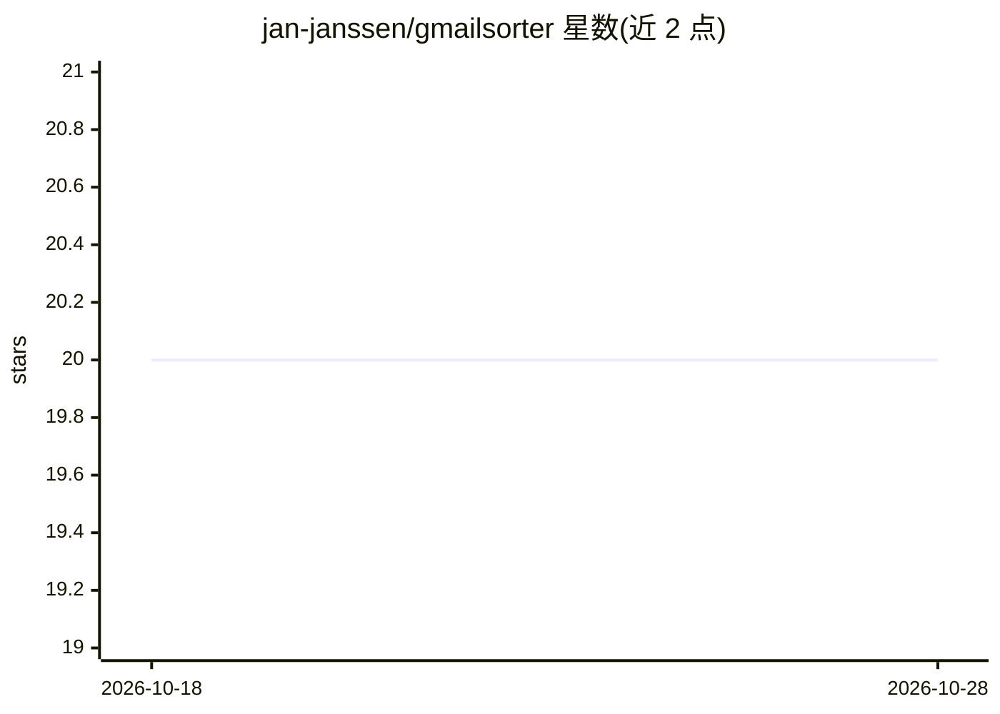

# jan-janssen/gmailsorter

⭐ 20 · Python · BSD-3-Clause · 推送 2026-10-26 · [GitHub](https://github.com/jan-janssen/gmailsorter) · [官网](http://gmailsorter.readthedocs.io) · 个人维护

**基于相似度学习自动分类 Gmail 邮件的服务端工具**

服务端邮件分类工具：将新邮件从收件箱移至自有收件箱，比较发件人、收件人、所属线程与标签，基于与历史已分类邮件的相似度（底层依赖 mailsort 的 RandomForest 机器学习核心）预测标签并自动归类；用户修改标签会作为反馈用于重训模型。提供 Gmail API、OAuth、同步守护进程与极简 Web UI，也可通过 gmailsorter.com 网络服务（私测中）或 Docker 容器部署，用户可继续使用原邮件客户端。

## 筛选速览

| 维度 | 判定 | 备注 |
|---|---|---|
| AI 角色 | `ai-native` | 本体是模型或模型工具 |
| 许可风险 | `permissive` | BSD-3-Clause |
| 部署形态 | `None` |  |
| 模型依赖 | — | README 未给出锁定关系 |
| 硬件要求 | — | 无带数字的原话,不猜 |
| 安装摩擦 | `low` | 无编译、无系统依赖或容器化 |
| 成熟度 | `idea` | |

## 能力要点

- 基于历史已分类邮件相似度预测新邮件标签
- 用户修改标签的反馈参与模型重训
- 依赖 mailsort 提供共享 IMAP 客户端与机器学习核心，可独立用于任意 IMAP 邮件服务器
- 服务端运行，不改变用户现有邮件客户端使用习惯

## 适用场景

- 让新邮件自动进入我定义的标签类别，减少打扰
- 保留自己习惯的邮件组织结构，由工具学习并延续
- 在任意 IMAP 邮件服务器上复用其机器学习分类核心

## 场景标签

 · 领域:邮件管理/机器学习

## 证据(README 行号)

> L42:  associated with to your previously sorted emails, and based on that predicts the email label for the new email.
> L8: machine learning core, which has no Google dependencies and can also be used on its own to sort

## 星数曲线

2026-10-18 20 → 2026-10-28 20（+0）

---
*卡片 v1 · prompt 1.4 · 生成 2026-10-28 · 置信度 high · 依据 README sha `0d2de27723a5` · [字段定义](../../DATASET.md)*
