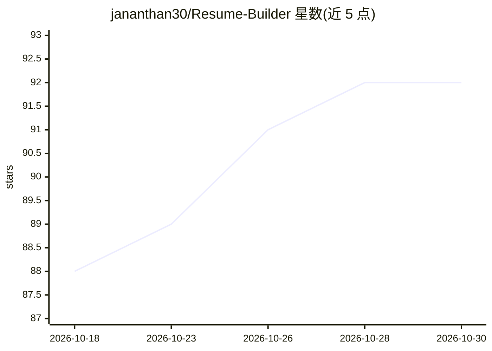

# jananthan30/Resume-Builder

⭐ 92 · Python · MIT · 推送 2026-08-15 · [GitHub](https://github.com/jananthan30/Resume-Builder) · 个人维护 · 中文 README

**面向求职者的简历/求职信生成工具：拒绝编造经历**

以 Claude Code 插件、Codex 插件或独立 Web 应用形式运行的简历与求职信生成工具。流程：从 Adzuna/Remotive/JSearch 检索职位并按简历匹配度打分排序；候选人契合度门槛（默认 50 分、零硬性淘汰）先于简历改写运行，不达标则拒绝定制并说明原因；改写采用 Researcher→Writer→Auditor→Editor 流程，独立审计者可否决写作者；产出 ATS 合规 DOCX、求职信并用 Excel 跟踪投递。评分用确定性引擎（关键词/语义匹配、招聘官式启发式、逐条证据匹配），LLM 仅做证据分类，分数可离线重放。需要 Python 3.10+ 与 config.json；LLM 评分需 ANTHROPIC_API_KEY，职位检索需 Adzuna key。

## 筛选速览

| 维度 | 判定 | 备注 |
|---|---|---|
| AI 角色 | `ai-native` | 本体是模型或模型工具 |
| 许可风险 | `permissive` | MIT |
| 部署形态 | `library` | 以包/库形式分发 |
| 模型依赖 | local-ok | 支持本地模型 |
| 硬件要求 | — | 无带数字的原话,不猜 |
| 安装摩擦 | `low` | 无编译、无系统依赖或容器化 |
| 成熟度 | — | 结构信号不足 |

## 能力要点

- 候选人契合度门槛先行，真实不匹配时拒绝定制并说明原因
- 逐条证据匹配：每个结论引用简历原文片段（含字符偏移），分数可无 LLM 重放
- Researcher→Writer→Auditor→Editor 改写流程，独立审计者可否决
- 8 个 MCP 评分工具支持云优先评分并本地回退

## 适用场景

- 上传简历+职位描述，获得匹配分数与招聘官式修改建议
- 按简历匹配度发现并排序目标职位（含薪资信息）
- 生成 ATS 合规 DOCX 简历与求职信并跟踪投递记录
- 审计简历要点是否符合 10 条写作规则

## 场景标签

`AI 写作` · 领域:内容生成

## 证据(README 行号)

> L3: Every AI resume tool promises to "beat the ATS." This one has a harder rule:
> L52: 7. **Generates** production-ready DOCX files (resume + cover letter)
> L105: /resume-builder:resume [paste a job description here]

## 星数曲线

2026-10-18 88 → 2026-10-30 92（+4）

---
*卡片 v1 · prompt 1.4 · 生成 2026-10-23 · 置信度 mid · 依据 README sha `36595ae06d0f` · [字段定义](../../DATASET.md)*
