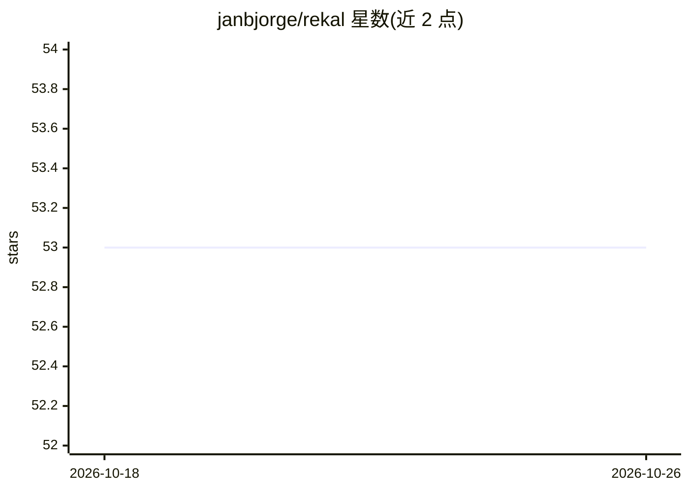

# janbjorge/rekal

⭐ 53 · Python · MIT · 推送 2026-08-26 · [GitHub](https://github.com/janbjorge/rekal) · [官网](https://pypi.org/project/rekal/) · 个人维护

**给 AI 编码 agent 的本地长期记忆 MCP 服务器**

rekal 是一个 MCP 服务器，为 Claude Code、Codex CLI、OpenCode、Cursor CLI 等 MCP 兼容 agent 提供跨会话持久记忆。记忆存储在本地单个 SQLite 文件（~/.rekal/memory.db），通过 BM25 关键词索引、384 维本地向量嵌入与时间衰减混合检索召回，无网络调用与 API key。暴露三个 MCP 工具（store/build_context/delete），并为 Claude Code 提供含 6 个 hook 与 4 个技能的插件；需手动关闭 Claude Code 内建 auto memory 以避免竞争。要求 Python 3.11+，pip/uv 安装。

## 筛选速览

| 维度 | 判定 | 备注 |
|---|---|---|
| AI 角色 | `ai-ecosystem` | LLM/agent 周边工具 |
| 许可风险 | `permissive` | MIT |
| 部署形态 | `library` | 以包/库形式分发 |
| 模型依赖 | locked-api |  |
| 硬件要求 | — | 无带数字的原话,不猜 |
| 安装摩擦 | `low` | 无编译、无系统依赖或容器化 |
| 成熟度 | — | 结构信号不足 |

## 能力要点

- 单个 SQLite 文件存储全部状态，本地计算嵌入与索引，无网络调用
- BM25 + 384 维向量 + 时间衰减的混合检索打分
- Claude Code 插件提供 SessionStart/UserPromptSubmit 等 6 个 hook 与 4 个技能
- 仅暴露 3 个 MCP 工具，另有 health/export/prune/recall CLI 管理命令

## 适用场景

- 让编码 agent 在跨会话间记住偏好、决策与项目知识
- 在上下文压缩前自动保存耐久事实避免丢失
- 按项目作用域检索、导出或清理历史记忆

## 场景标签

`Agent 记忆` · 领域:Agent 开发

## 证据(README 行号)

> L5: rekal is an MCP server that gives AI coding agents persistent memory across sessions. Memories are stored locally in
> L9: Works with any MCP-capable agent: Claude Code, Codex CLI, OpenCode, Cursor CLI.

## 星数曲线

2026-10-18 53 → 2026-10-26 53（+0）

---
*卡片 v1 · prompt 1.4 · 生成 2026-10-24 · 置信度 high · 依据 README sha `8c4c3d8fd8b2` · [字段定义](../../DATASET.md)*
