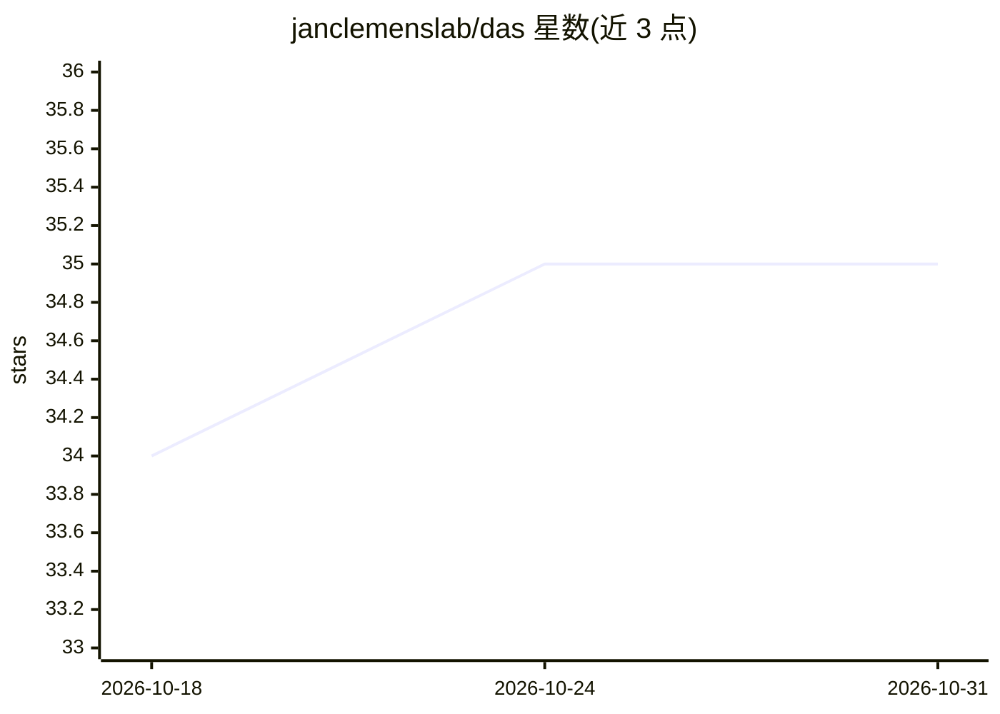

# janclemenslab/das

⭐ 35 · Python · Apache-2.0 · 推送 2026-10-27 · [GitHub](https://github.com/janclemenslab/das) · [官网](http://janclemenslab.org/das/) · 组织维护

**用深度神经网络自动标注动物发声的音频分割工具**

DAS 通过深度神经网络对原始音频录音中的动物发声进行自动标注，可在手动标注基础上训练网络并生成新标注。提供图形界面（PySide6）、终端命令行与 Python 脚本三种使用方式，附有果蝇与鸟类快速上手教程。安装经 conda 环境 + uv pip 完成，支持 CPU/GPU 选项；TensorFlow 后端用户需按最终 TF 版本（0.32.13）的说明安装。由 Jan Clemens 实验室维护，方法发表于 eLife。

## 筛选速览

| 维度 | 判定 | 备注 |
|---|---|---|
| AI 角色 | `ai-native` | 本体是模型或模型工具 |
| 许可风险 | `permissive` | Apache-2.0 |
| 部署形态 | `library` | 以包/库形式分发 |
| 模型依赖 | — | README 未给出锁定关系 |
| 硬件要求 | — | 无带数字的原话,不猜 |
| 安装摩擦 | `medium` | 含编译或系统依赖之一 |
| 成熟度 | — | 结构信号不足 |

## 能力要点

- 深度神经网络自动标注原始录音中的动物发声
- GUI / 终端 / Python 脚本三种使用方式
- 提供果蝇与鸟类教程，覆盖手动标注、网络训练与生成标注

## 适用场景

- 对动物发声录音做自动标注，减少人工标注工作
- 在已有手动标注上训练网络生成新数据集标注
- 科研实验室批处理分析声学行为数据

## 场景标签

`科研工具` · 领域:学习与行业

## 证据(README 行号)

> L3: _DAS_ automatically annotates animal vocalizations in raw audio recordings using a deep neural network. It can be us
> L45: Elsa Steinfath, Adrian Palacios, Julian Rottschäfer, Deniz Yuezak, Jan Clemens (2021). _Fast and accurate annotatio

## 星数曲线

2026-10-18 34 → 2026-10-31 35（+1）

---
*卡片 v1 · prompt 1.4 · 生成 2026-10-25 · 置信度 high · 依据 README sha `88e844957dac` · [字段定义](../../DATASET.md)*
