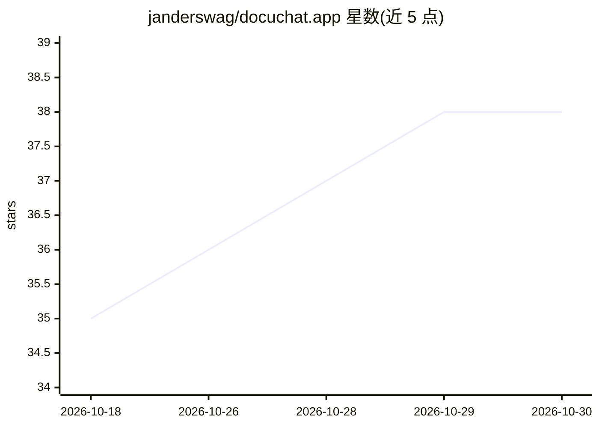

# janderswag/docuchat.app

⭐ 38 · Python · MIT · 推送 2026-07-22 · [GitHub](https://github.com/janderswag/docuchat.app) · [官网](https://docuchat.app/) · 个人维护

**面向律师的私有本地法律文档问答桌面应用，答案带页码引证**

面向独资与小所律师的自托管文档智能工具：将法律 PDF、扫描件与庭审笔录导入 matter，检索与生成全部在本地运行（Ollama 本地模型 + LanceDB 嵌入式向量库，绑定 127.0.0.1），回答给出文件/页码/精确文本片段引证，且每条引文经字符级机械校验，不可核验的声明被丢弃。matter 摘要提取当事人、时间线与截止日期，同样经 span 校验，日期由律师确认后可加入日历。提供 macOS 一键桌面安装包，也可用 Docker Compose 或源码运行。明确声明非 AI 律师、非自主 agent，不给法律意见。

## 筛选速览

| 维度 | 判定 | 备注 |
|---|---|---|
| AI 角色 | `ai-native` | 本体是模型或模型工具 |
| 许可风险 | `permissive` | MIT |
| 部署形态 | `self-host` | docker 或自建部署 |
| 模型依赖 | local-ok | 支持本地模型 |
| 硬件要求 | — | 无带数字的原话,不猜 |
| 安装摩擦 | `low` | 无编译、无系统依赖或容器化 |
| 成熟度 | — | 结构信号不足 |

## 能力要点

- 引文机械校验：字符级确认引文存在于被引来源，不可核验即丢弃
- 全程本地：Ollama 推理/嵌入/OCR/存储均不出机，查询路径零云端调用
- matter 预过滤检索，单一客户文档不会泄漏进其他 matter 的回答
- 28 个用户自带密钥的文档连接器，含表格抽取与 Tesseract OCR

## 适用场景

- 在不上传特权文件到云端厂商的前提下，跨案卷文档问答
- 自动生成带页码引证的 matter 概览（当事人/时间线/截止日期）并确认后入日历
- 对合同运行条款清单核查，逐条给出引证或标记疑似缺失
- 一次性多文档审查：行=文档、列=问题、格=带引证答案

## 场景标签

`文档问答` `文档解析` · 领域:知识与检索

## 证据(README 行号)

> L23: This project is a **self-hosted, privacy-first** document-intelligence stack that runs **100% locally**:
> L26: - **Open-source / local models** via Ollama. No API keys, no per-token billing, no vendor lock-in.
> L120: 4. **Answer.** `qwen3:14b` answers from the retrieved context under a strict grounded-and-cite-or-refuse prompt.

## 星数曲线

2026-10-18 35 → 2026-10-30 38（+3）

---
*卡片 v1 · prompt 1.4 · 生成 2026-10-25 · 置信度 high · 依据 README sha `94b7e5a3f4b7` · [字段定义](../../DATASET.md)*
