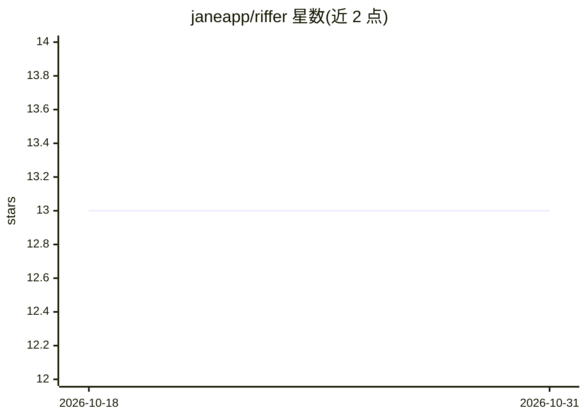

# janeapp/riffer

⭐ 13 · Ruby · MIT · 推送 2026-10-30 · [GitHub](https://github.com/janeapp/riffer) · [官网](http://riffer.ai/) · 组织维护

**构建 AI 应用与 Agent 的 Ruby 一体化框架**

面向 Ruby 开发者的 AI 应用与 Agent 构建框架，以 gem 形式发布（要求 Ruby 3.3/3.4/4.0）。提供 Agent 定义、生成/流式响应、Agent 循环与工具执行、消息格式、Evals 评估、Guardrails 输入输出校验、Skills 打包能力、MCP 第三方服务器集成、序列化与 OpenTelemetry 追踪，并通过 provider 适配器接入多家 LLM 提供商。文档与 API 参考发布于 riffer.ai，开发配套 bin/ 脚本与 VCR 录制测试流程。

## 筛选速览

| 维度 | 判定 | 备注 |
|---|---|---|
| AI 角色 | `ai-ecosystem` | LLM/agent 周边工具 |
| 许可风险 | `permissive` | MIT |
| 部署形态 | `None` |  |
| 模型依赖 | locked-api |  |
| 硬件要求 | — | 无带数字的原话,不猜 |
| 安装摩擦 | `low` | 无编译、无系统依赖或容器化 |
| 成熟度 | — | 结构信号不足 |

## 能力要点

- Agent 生命周期、Agent 循环与工具执行流程
- Guardrails 输入输出校验与 Evals 质量评估
- MCP 第三方服务器集成与 Skills 打包能力
- 多 LLM 提供商适配器与 OpenTelemetry 追踪

## 适用场景

- 在 Ruby 项目中构建带工具调用的 AI Agent
- 为 Agent 接入 OpenAI/Anthropic/Bedrock/Gemini 等提供商
- 用 Evals 与 Guardrails 评估和约束 Agent 行为

## 场景标签

`Agent 框架` · 领域:Agent 开发

## 证据(README 行号)

> L3: The all-in-one Ruby framework for building AI-powered applications and agents.
> L54: - Providers - LLM provider adapters

## 星数曲线

2026-10-18 13 → 2026-10-31 13（+0）

---
*卡片 v1 · prompt 1.4 · 生成 2026-10-31 · 置信度 high · 依据 README sha `486bab0f4282` · [字段定义](../../DATASET.md)*
