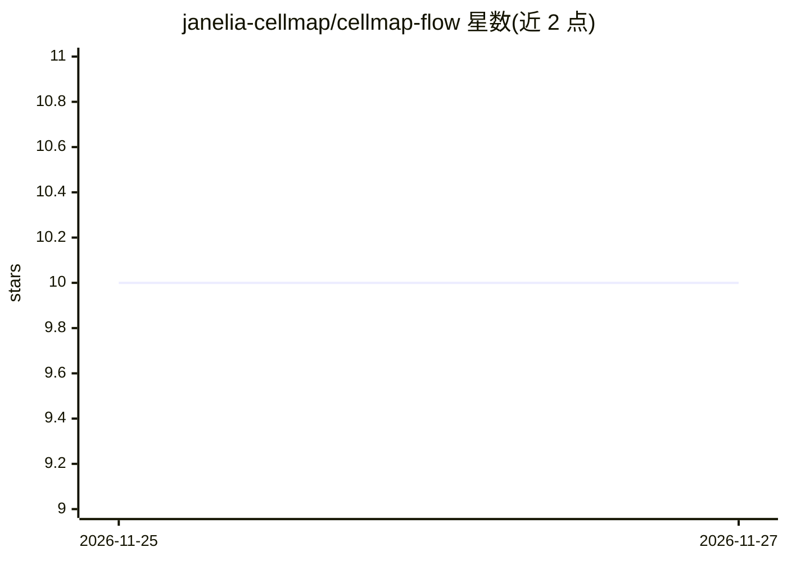

# janelia-cellmap/cellmap-flow

⭐ 10 · Python · BSD-3-Clause · 推送 2026-11-25 · [GitHub](https://github.com/janelia-cellmap/cellmap-flow) · [官网](https://janelia-cellmap.github.io/cellmap-flow/) · 组织维护

**在 Neuroglancer 中对 3D 显微数据做即时推理与在线微调的工具**

面向大规模三维显微（EM）数据的深度学习推理与微调工具：在浏览 Neuroglancer 视图时对屏幕内容即时计算分割预测，支持原地涂画标注并用 LoRA 或全网络微调模型，微调结果可与原模型并排对比。支持多类模型来源（BioImage Model Zoo、Cellpose-SAM、ONNX、PyTorch/TensorFlow 脚本）与多种数据格式（zarr、N5、precomputed，本地或 s3/gs/https URL）。提供 CLI 与浏览器版（WebGPU），服务器模式额外支持集群分块运行整卷推理。

## 筛选速览

| 维度 | 判定 | 备注 |
|---|---|---|
| AI 角色 | `ai-native` | 本体是模型或模型工具 |
| 许可风险 | `permissive` | BSD-3-Clause |
| 部署形态 | `library` | 以包/库形式分发 |
| 模型依赖 | — | README 未给出锁定关系 |
| 硬件要求 | — | 无带数字的原话,不猜 |
| 安装摩擦 | `low` | 无编译、无系统依赖或容器化 |
| 成熟度 | `idea` | |

## 能力要点

- 屏幕内容就近即时计算预测并缓存复用
- 涂画标注后原地微调（LoRA/全网络/浏览器 GPU）
- 支持 BioImage Model Zoo、Cellpose-SAM、ONNX、PyTorch/TensorFlow 脚本等多类模型
- 浏览器版经 WebGPU 在本地 GPU 运行模型，支持分享链接

## 适用场景

- 浏览 EM 体数据时实时查看分割模型预测
- 涂画修正模型错误并在线微调
- 对整卷数据在集群上分块运行推理并保存为 OME-Zarr
- 按涂画匹配度从多个模型中挑选初始模型

## 场景标签

`目标检测` `微调` · 领域:感知与多模态

## 证据(README 行号)

> L3:  Run segmentation models on any EM volume, on disk or in the cloud, and see their predictions in Neuroglancer as you
> L29: - **Live.** Predictions are computed for what is on screen, nearest first, and
> L36: - **Finetune in place.** Paint where a model is wrong and train it: with LoRA

## 星数曲线

2026-11-25 10 → 2026-11-27 10（+0）

---
*卡片 v1 · prompt 1.4 · 生成 2026-11-24 · 置信度 high · 依据 README sha `1b31d28dce39` · [字段定义](../../DATASET.md)*
