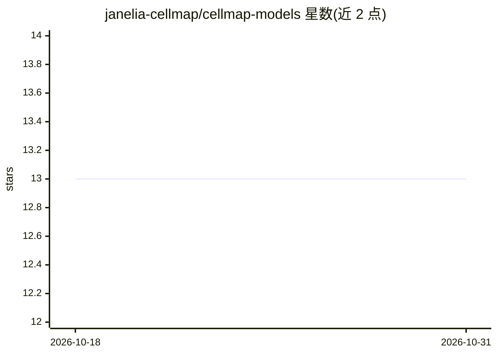

# janelia-cellmap/cellmap-models

⭐ 13 · Python · BSD-3-Clause · 推送 2026-10-26 · [GitHub](https://github.com/janelia-cellmap/cellmap-models) · [官网](https://janelia-cellmap.github.io/cellmap-models/) · 组织维护

**CellMap 电镜细胞分割模型与权重的 Python 模型库**

HHMI Janelia CellMap 项目团队发布的 Python 包：提供用于体积电镜图像细胞器分割的模型架构与网络权重（含 COSEM 先导项目发表的全细胞细胞器分割模型），通过 load_model 按名称加载。附带模型导出工具，可将 PyTorch/DaCapo 模型导出为 pickle、torch.export、TorchScript、ONNX 等格式并生成元数据与模型卡，支持推理、微调加载及推送到 Hugging Face Hub。推荐在 conda 环境中 pip 安装。

## 筛选速览

| 维度 | 判定 | 备注 |
|---|---|---|
| AI 角色 | `ai-native` | 本体是模型或模型工具 |
| 许可风险 | `permissive` | BSD-3-Clause |
| 部署形态 | `library` | 以包/库形式分发 |
| 模型依赖 | — | README 未给出锁定关系 |
| 硬件要求 | — | 无带数字的原话,不猜 |
| 安装摩擦 | `low` | 无编译、无系统依赖或容器化 |
| 成熟度 | — | 结构信号不足 |

## 能力要点

- 收录 COSEM 项目全细胞细胞器分割模型权重，按名称加载
- 导出为 PyTorch/torch.export/TorchScript/ONNX 多格式并自动生成模型卡
- 导出模型支持推理加载与微调（unflatten 恢复训练结构）
- 一键推送导出模型到 Hugging Face Hub

## 适用场景

- 对体积电镜数据做细胞器分割推理
- 复用或微调已发表的 CellMap/COSEM 分割模型
- 将训练好的分割模型导出为 ONNX 做跨框架部署或发布到 Hub

## 场景标签

`目标检测` `微调` · 领域:感知与多模态

## 证据(README 行号)

> L16: This package contains the models used for segmention by the CellMap project team at HHMI Janelia.
> L34: Different models are available in the `cellmap-models` module. For example, to use the models produced by the `COSE

## 星数曲线

2026-10-18 13 → 2026-10-31 13（+0）

---
*卡片 v1 · prompt 1.4 · 生成 2026-10-31 · 置信度 high · 依据 README sha `c12b4af7dd33` · [字段定义](../../DATASET.md)*
