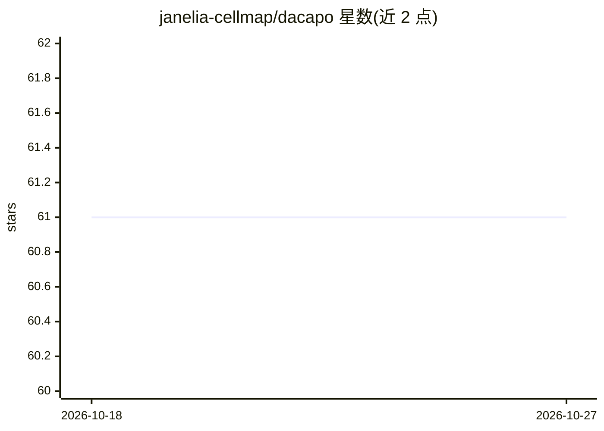

# janelia-cellmap/dacapo

⭐ 61 · Python · BSD-3-Clause · 推送 2026-04-24 · [GitHub](https://github.com/janelia-cellmap/dacapo) · [官网](https://janelia-cellmap.github.io/dacapo/) · 组织维护

**在大规模多维图像上应用机器学习（分割）的框架**

由 Janelia CellMap 团队维护的 Python 框架，将机器学习任务配置为 DataSplits、Architectures、Tasks、Trainers 的组合，作用于任意大的多维图像体积。支持实例分割、语义分割、Affinities、局部形状描述符、带符号距离等任务。不绑定特定学习框架，当前仅支持 torch，计划支持 tensorflow。通过 pip 安装，可选使用 MongoDB 存储输出，计算上下文（集群与否）在 dacapo.yaml 中配置。附带 Colab 最小教程与 arXiv 论文。

## 筛选速览

| 维度 | 判定 | 备注 |
|---|---|---|
| AI 角色 | `ai-native` | 本体是模型或模型工具 |
| 许可风险 | `permissive` | BSD-3-Clause |
| 部署形态 | `library` | 以包/库形式分发 |
| 模型依赖 | — | README 未给出锁定关系 |
| 硬件要求 | — | 无带数字的原话,不猜 |
| 安装摩擦 | `low` | 无编译、无系统依赖或容器化 |
| 成熟度 | — | 结构信号不足 |

## 能力要点

- 以 DataSplits/Architectures/Tasks/Trainers 组合配置 ML 任务
- 支持实例分割、语义分割、Affinities、局部形状描述符等任务
- 处理任意大体积多维图像（zarr/n5 分块存储生态）
- 可选 MongoDB 存储输出与集群计算上下文配置

## 适用场景

- 对大型生物显微图像做实例/语义分割训练与预测
- 在集群上运行大规模图像分割流水线
- 复用已发布模型（如 COSEM 训练的 pytorch 网络）

## 场景标签

`目标检测` · 领域:感知与多模态

## 证据(README 行号)

> L17: A framework for easy application of established machine learning techniques on large, multi-dimensional images.
> L26: framework, but currently only supports `torch` with
> L51:  - Instance Segmentation

## 星数曲线

2026-10-18 61 → 2026-10-27 61（+0）

---
*卡片 v1 · prompt 1.4 · 生成 2026-10-24 · 置信度 high · 依据 README sha `8bc75adf41fe` · [字段定义](../../DATASET.md)*
