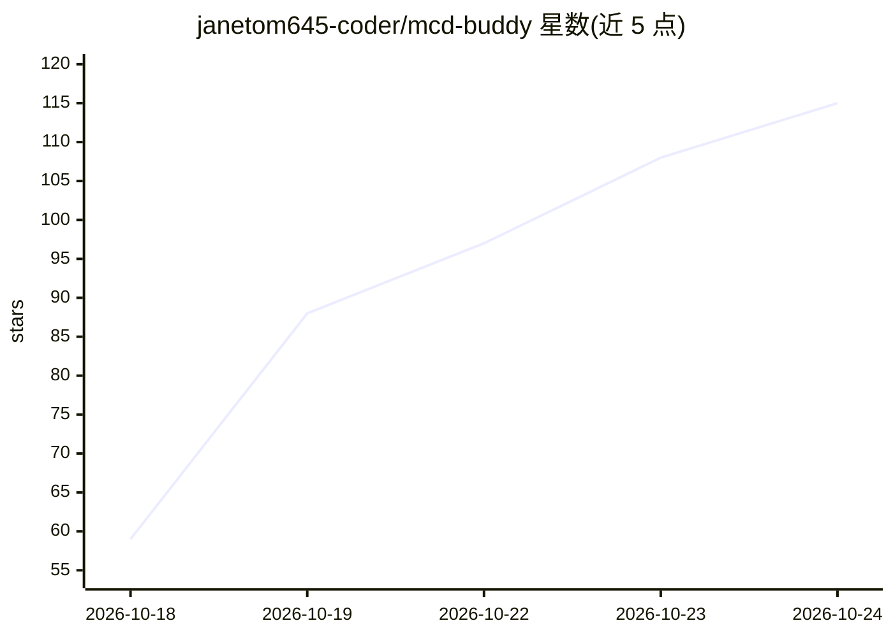

# janetom645-coder/mcd-buddy

⭐ 116 · Python · MIT · 推送 2026-10-10 · [GitHub](https://github.com/janetom645-coder/mcd-buddy) · [官网](https://github.com/janetom645-coder/mcd-buddy) · 个人维护 · 中文 README

**麦当劳中国 MCP 的命令行客户端：点餐记录/团餐/改配/运势四玩法**

基于麦当劳中国官方 MCP 服务（35 个 Tool 中使用 13 个）的 Python 命令行工具，含四个模块：修行录（点餐打卡与成就）、团餐指挥官（按预算/口味/忌口合成团餐）、隐藏菜单实验室（套餐改配并经 calculate-price 实时核价、营养对比）、每日运势签。提供 --demo 离线模式（逐字段复刻真实响应、无需 Token）与 --json 输出。价格实时核算、推荐与营养打分均为确定性算法而非 LLM 生成；只做查询与试算，不自动下单。192 个测试、MIT 许可。

## 筛选速览

| 维度 | 判定 | 备注 |
|---|---|---|
| AI 角色 | `ai-ecosystem` | LLM/agent 周边工具 |
| 许可风险 | `permissive` | MIT |
| 部署形态 | `library` | 以包/库形式分发 |
| 模型依赖 | — | README 未给出锁定关系 |
| 硬件要求 | — | 无带数字的原话,不猜 |
| 安装摩擦 | `medium` | 含编译或系统依赖之一 |
| 成熟度 | — | 结构信号不足 |

## 能力要点

- 调用麦当劳中国官方 MCP（mcp.mcd.cn，Streamable HTTP + Bearer Token）
- --demo 离线模式与线上响应同构，无需 Token 可复现
- 改配价格走真实 calculate-price 实时核价，降级估算时明确标注
- 只查询与试算，不调用下单/抽奖/积分扣减类工具

## 适用场景

- 记录自己的麦当劳点餐并解锁成就段位
- 帮一群人按预算和忌口自动合成团餐方案
- DIY 套餐改配并对比营养与价格

## 场景标签

 · 领域:餐饮/消费工具

## 证据(README 行号)

> L9:  一个真正懂麦当劳的 AI 助手 —— 基于麦当劳中国官方 MCP，把点餐这件事玩出四种花样。
> L308: 本项目真实调用麦当劳中国官方 MCP 服务（`https://mcp.mcd.cn`，Streamable HTTP，Bearer Token 鉴权），

## 星数曲线

2026-10-18 59 → 2026-10-24 115（+56）

---
*卡片 v1 · prompt 1.4 · 生成 2026-10-23 · 置信度 high · 依据 README sha `41c699716ddc` · [字段定义](../../DATASET.md)*
