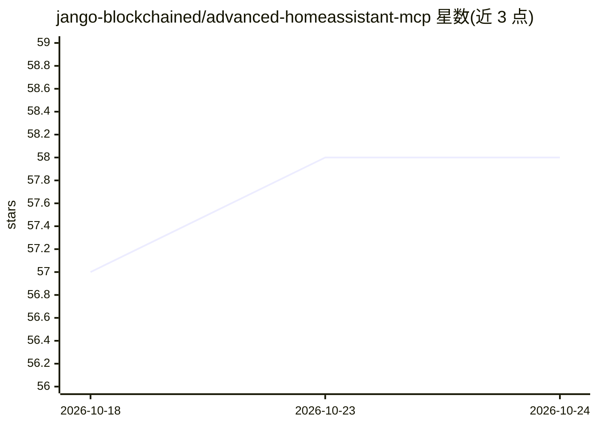

# jango-blockchained/advanced-homeassistant-mcp

⭐ 58 · JavaScript · Apache-2.0 · 推送 2026-06-14 · [GitHub](https://github.com/jango-blockchained/advanced-homeassistant-mcp) · [官网](https://jango-blockchained.github.io/advanced-homeassistant-mcp/) · 个人维护

**让 AI 助手通过 MCP 控制 Home Assistant 的服务端**

一个 Model Context Protocol server，把 Home Assistant 的设备与功能暴露给 AI 助手（Claude、GPT、Cursor、Copilot 等），提供 50+ 工具，覆盖灯光、空调、门锁、扫地机、报警、自动化、通知、历史查询、仪表板管理等类别。支持 STDIO、HTTP+WS、HTTP 三种传输。另含本地语音功能：基于 wyoming-openwakeword 的唤醒词检测与 faster-whisper 的本地语音转文字，经 Docker Compose 启用。需 Home Assistant 实例与长期访问令牌。

## 筛选速览

| 维度 | 判定 | 备注 |
|---|---|---|
| AI 角色 | `ai-ecosystem` | LLM/agent 周边工具 |
| 许可风险 | `permissive` | Apache-2.0 |
| 部署形态 | `self-host` | docker 或自建部署 |
| 模型依赖 | — | README 未给出锁定关系 |
| 硬件要求 | — | 无带数字的原话,不猜 |
| 安装摩擦 | `low` | 无编译、无系统依赖或容器化 |
| 成熟度 | — | 结构信号不足 |

## 能力要点

- 50+ 工具覆盖灯光/空调/门锁/自动化/历史/能源监控等 Home Assistant 类别
- STDIO、HTTP+WS（含 JWT 认证与限流）、HTTP 三种传输方式
- 本地语音功能：唤醒词检测 + faster-whisper 本地转写
- 提供 bunx/npx/Docker/Smithery/npm/源码等多种安装方式

## 适用场景

- 通过对话让 Claude 或 Cursor 控制家里的智能设备
- 为远程 AI 主机提供带认证的 Home Assistant 接入通道
- 搭建本地语音控制的智能家居助手

## 场景标签

`语音识别` · 领域:感知与多模态

## 证据(README 行号)

> L12: > **Talk to your house.** Your AI assistant (Claude, GPT, Cursor, Copilot) — connected to Home Assistant through th
> L148: ┌──────────────┐     ┌─────────────────────┐     ┌──────────────────┐
> L150: │ (Claude/GPT)  │     │    MCP Server       │     │  (Home Assistant)│

## 星数曲线

2026-10-18 57 → 2026-10-24 58（+1）

---
*卡片 v1 · prompt 1.4 · 生成 2026-10-24 · 置信度 high · 依据 README sha `3fa2e3eebc88` · [字段定义](../../DATASET.md)*
