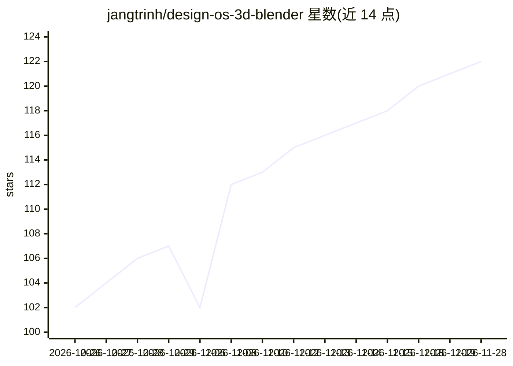

# jangtrinh/design-os-3d-blender

⭐ 122 · Python · NOASSERTION · 推送 2026-11-16 · [GitHub](https://github.com/jangtrinh/design-os-3d-blender) · [官网](https://jangtrinh.github.io/design-os-3d-blender/) · 个人维护

**让编码 agent 通过 MCP 在 Blender 中建模并交付可打印零件**

面向 Blender 5.2 的 MCP 服务器与 agent 技能：编码 agent（Claude Code、Codex、Gemini CLI 等）通过四个工具查询 bpy 知识库、校验毫米锁定规格、执行无头 bpy 脚本，并以 AGENT_OK/AGENT_FAIL 单行判定结果；3D 打印生产门检查流形几何、壁厚与尺寸边界，导出 STL 与 glTF。提供 /doctor 诊断与离线自检脚本；声明所有执行在本地进行，不外发数据。不适用的范围包括钣金折迭、有机角色雕刻与 2D UI 动效。

## 筛选速览

| 维度 | 判定 | 备注 |
|---|---|---|
| AI 角色 | `ai-ecosystem` | LLM/agent 周边工具 |
| 许可风险 | `none` | NOASSERTION |
| 部署形态 | `library` | 以包/库形式分发 |
| 模型依赖 | — | README 未给出锁定关系 |
| 硬件要求 | — | 无带数字的原话,不猜 |
| 安装摩擦 | `low` | 无编译、无系统依赖或容器化 |
| 成熟度 | — | 结构信号不足 |

## 能力要点

- 四个 MCP 工具：运行时状态、bpy 5.2 知识库检索、规格校验、无头执行
- AGENT_OK/AGENT_FAIL 机器可读执行契约
- 3D 打印生产门：流形、壁厚、毫米锁定边界检查
- 同一 SKILL.md 兼容 Claude Code / Codex / Gemini CLI / Cursor 等

## 适用场景

- 让编码 agent 从照片和规格生成可打印机械零件
- 3D 打印前自动检查流形几何与壁厚
- 为 bpy 脚本编写检索已验证的 Blender 5.2 知识库

## 场景标签

`编码 Agent` · 领域:编码与开发

## 证据(README 行号)

> L5: **An MCP server and agent skill for Blender 5.2.** Your coding agent models, renders and checks mechanical parts on 
> L71: The MCP server exposes **four tools**. That is the count in `src/design_os_3d_blender_mcp/server.py` on this branch
> L84: The Claude Code, Codex and other agent plugins install the same skill, `skills/design-os-3d-blender/SKILL.md`. `/do

## 星数曲线

2026-10-26 102 → 2026-11-28 122（+20）

---
*卡片 v1 · prompt 1.4 · 生成 2026-11-28 · 置信度 high · 依据 README sha `e00b90e9a389` · [字段定义](../../DATASET.md)*
