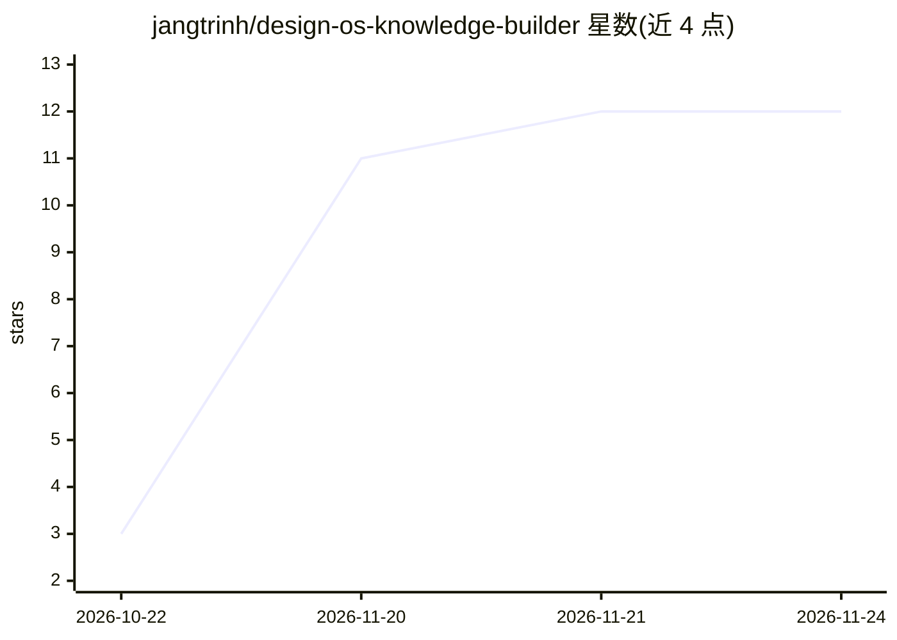

# jangtrinh/design-os-knowledge-builder

⭐ 12 · Python · NOASSERTION · 推送 2026-11-16 · [GitHub](https://github.com/jangtrinh/design-os-knowledge-builder) · [官网](https://jangtrinh.github.io/design-os-knowledge-builder/) · 个人维护

**为 AI 编码代理提供可溯源知识包构建与证据停止门控的本地 CLI**

本地 Python CLI 与 agent skill：把网页、命令输出冻结为带 sha256 的来源，将引文提升为 claim，`verify --claims` 逐条核对引文是否存在于冻结文件中。停止门控读取研究账本，依据饱和度（3 轮低增量）、独立评审、执行证据等条件输出四种决策。核心机制包括引文最短长度校验、评审文件哈希校验、`--recheck` 现场重抓页面防伪造。要求 Python 3.10+，零第三方依赖，本地运行无遥测；许可为 PolyForm Shield 1.0.0（source-available）。

## 筛选速览

| 维度 | 判定 | 备注 |
|---|---|---|
| AI 角色 | `ai-ecosystem` | LLM/agent 周边工具 |
| 许可风险 | `none` | NOASSERTION |
| 部署形态 | `library` | 以包/库形式分发 |
| 模型依赖 | — | README 未给出锁定关系 |
| 硬件要求 | — | 无带数字的原话,不猜 |
| 安装摩擦 | `low` | 无编译、无系统依赖或容器化 |
| 成熟度 | — | 结构信号不足 |

## 能力要点

- 九个 CLI 命令覆盖 ingest/verify/gate/pack/query 等环节
- 停止门控输出 STOP_SUFFICIENT/DEEPEN/PAUSE_BUDGET/ABSTAIN_BLOCKED 四种决策
- 冻结来源以 sha256 与路径比对校验引文真实性
- skill 分层加载以控制 agent 上下文体积（SKILL.md 限 120 行）

## 适用场景

- 让 Claude Code 等代理按流程构建可核查的主题知识包
- 研究任务中判定证据是否足够、是否继续深挖
- 对已有知识包做引文核验与索引查询

## 场景标签

`RAG` · 领域:知识与检索

## 证据(README 行号)

> L5: A local Python CLI and an agent skill for knowledge packs where every claim quotes a file you froze. You save web pa
> L7: Version 1.0.0, from `pyproject.toml`. Python 3.10 or later, and no third-party runtime dependencies (`dependencies =

## 星数曲线

2026-10-22 3 → 2026-11-24 12（+9）

---
*卡片 v1 · prompt 1.4 · 生成 2026-11-20 · 置信度 high · 依据 README sha `94a36367602d` · [字段定义](../../DATASET.md)*
