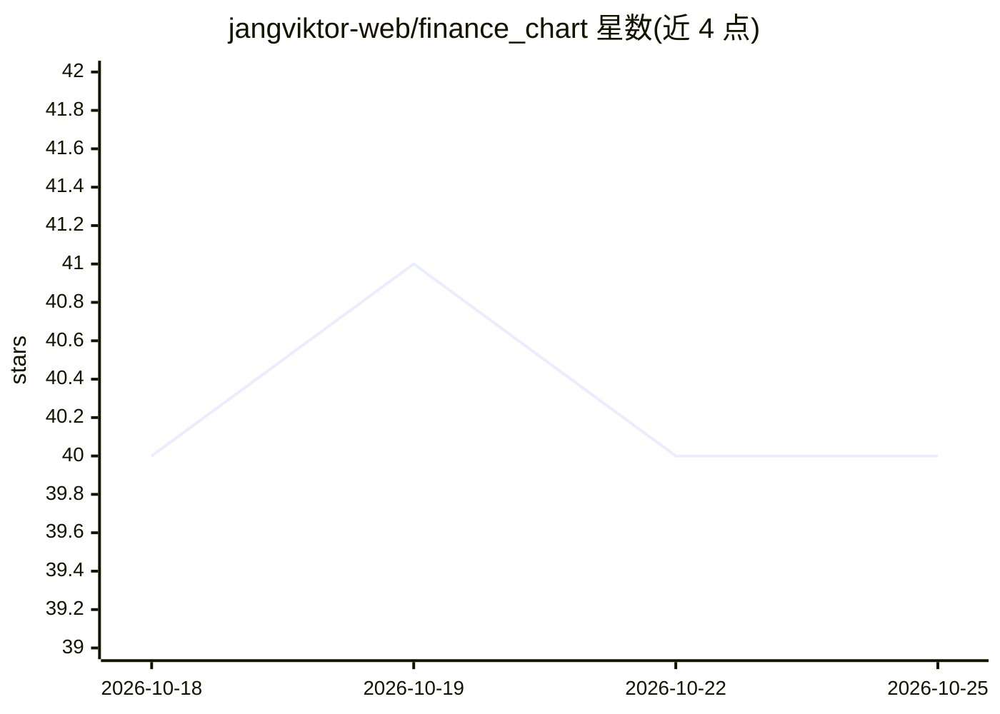

# jangviktor-web/finance_chart

⭐ 40 · Dart · 推送 2026-09-20 · [GitHub](https://github.com/jangviktor-web/finance_chart) · 个人维护 · 中文 README

**开源免费的 A 股量化分析 Android APP，含 AI 选股诊断**

基于 Flutter 构建的 A 股量化分析 Android 应用，无需后端服务。功能包括 25+ 技术指标（MACD/KDJ/RSI/BOLL 等）、K 线分时图、AI 智能选股与诊断（接入东方财富妙想 API）、资金流向与北向资金追踪、龙虎榜解读、宏观数据（CPI/PMI/GDP/M2）、5 大策略选股扫描与策略回测（收益率/回撤/夏普比率）。数据来自东方财富、腾讯、百度等公开免费 API，多源自动降级；API Key 存于系统级安全存储。提供 4 种 APK 安装包或源码构建。

## 筛选速览

| 维度 | 判定 | 备注 |
|---|---|---|
| AI 角色 | `ai-enhanced` | 去掉 AI 部分产品仍成立 |
| 许可风险 | `none` | — |
| 部署形态 | `None` |  |
| 模型依赖 | — | README 未给出锁定关系 |
| 硬件要求 | — | 无带数字的原话,不猜 |
| 安装摩擦 | `low` | 无编译、无系统依赖或容器化 |
| 成熟度 | — | 结构信号不足 |

## 能力要点

- 25+ 技术指标，参数全部可调，指标计算在独立线程（isolate）
- AI 诊断/深度分析/选股/对话，接入东方财富妙想与同花顺热度中心
- 多源数据自动降级与按域名限流
- 策略回测输出收益率/回撤/夏普比率

## 适用场景

- 在手机上查看 A 股行情、K 线与技术指标
- 用自然语言条件让 AI 推荐股票并生成诊断报告
- 追踪主力资金、北向资金与龙虎榜席位
- 对均线交叉、KDJ 金叉等策略做历史回测

## 场景标签

`金融量化` · 领域:学习与行业

## 证据(README 行号)

> L14: 开源免费的 **A 股量化分析 Android APP**，基于 Flutter 构建，无需后端服务。集成 **25+ 技术指标**、**AI 智能选股与诊断**、**资金流向分析**、**北向资金追踪**、**龙虎榜解读**、*
> L121: ### 🤖 AI 智能选股与诊断（东方财富妙想）

## 星数曲线

2026-10-18 40 → 2026-10-25 40（+0）

---
*卡片 v1 · prompt 1.4 · 生成 2026-10-25 · 置信度 high · 依据 README sha `73302090d586` · [字段定义](../../DATASET.md)*
