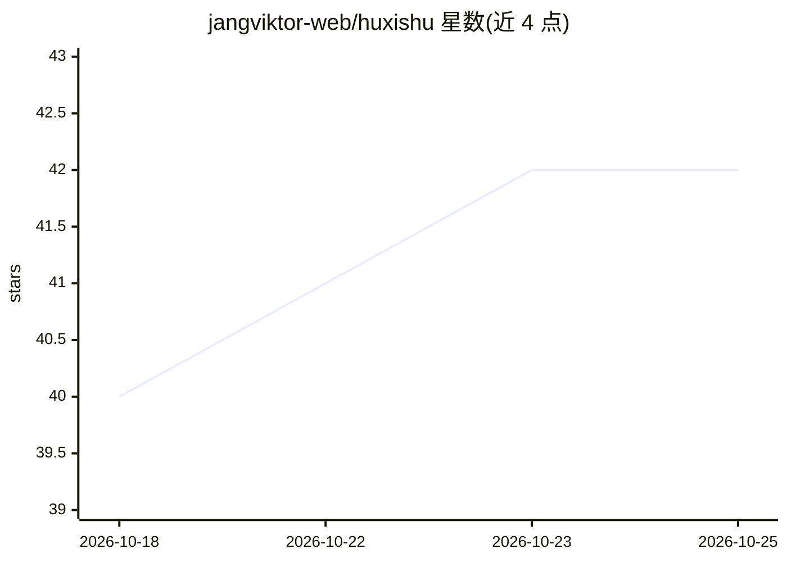

# jangviktor-web/huxishu

⭐ 42 · HTML · 推送 2026-08-23 · [GitHub](https://github.com/jangviktor-web/huxishu) · [官网](https://jangviktor-web.github.io/huxishu/) · 个人维护 · 中文 README

**将胡希恕六经八纲经方辨证体系注入 AI Agent 的技能包**

基于胡希恕（1898-1984）约38万字中日录音增补版讲稿（伤寒论398条+金匮要略22篇）蒸馏而成的 Agent Skill（SKILL.md + modules + references）。内容包括16个六经辨证IF-THEN公式、9组方证鉴别速查表、四大心智模型、七步条辨法、8个饮食调理模型与剂量换算体系，基于 tcm-distiller 蒸馏框架构建。通过 ClawHub/openclaw 命令、腾讯 IMA APP、腾讯 Skillhub 或 git clone 安装到 Claude 类 agent 中使用，激活词包括胡希恕、六经八纲、方证对应等。声明仅供学习研究，不替代专业医疗诊断。

## 筛选速览

| 维度 | 判定 | 备注 |
|---|---|---|
| AI 角色 | `ai-knowledge` | 知识聚合/清单类 |
| 许可风险 | `none` | — |
| 部署形态 | `None` |  |
| 模型依赖 | — | README 未给出锁定关系 |
| 硬件要求 | — | 无带数字的原话,不猜 |
| 安装摩擦 | `low` | 无编译、无系统依赖或容器化 |
| 成熟度 | — | 结构信号不足 |

## 能力要点

- 38万字讲稿蒸馏为16个六经辨证IF-THEN公式与9组方证鉴别速查表
- 398条伤寒论逐条讲解+22篇金匮要略全量蒸馏
- 七步条辨法与四大心智模型（六经来自八纲/方证尖端/正邪交争/胃气为本）
- 8个饮食调理模型与剂量换算体系（一两≈9克）

## 适用场景

- 让 AI Agent 以胡希恕视角进行六经辨证与方证鉴别
- 经方学习者查阅伤寒金匮条文的辨证要点讲解
- 在腾讯 IMA 或 Claude 类 agent 中查询经方临床选方思路

## 场景标签

 · 领域:中医/知识技能包

## 证据(README 行号)

> L20: 将胡希恕（1898-1984）的经方临床思维、六经八纲辨证体系、方证对应心法蒸馏为可激活的 Agent Skill，使 AI 能以胡希恕的视角进行六经辨证、方证鉴别、临床选方。
> L131: |**合计**|**38万字**|**SKILL.md + 2个modules + 8个references**|

## 星数曲线

2026-10-18 40 → 2026-10-25 42（+2）

---
*卡片 v1 · prompt 1.4 · 生成 2026-10-25 · 置信度 high · 依据 README sha `f7b57bac9611` · [字段定义](../../DATASET.md)*
