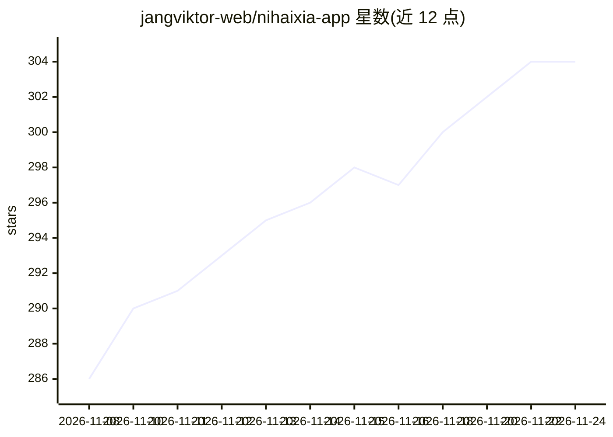

# jangviktor-web/nihaixia-app

⭐ 303 · Dart · Apache-2.0 · 推送 2026-11-23 · [GitHub](https://github.com/jangviktor-web/nihaixia-app) · [官网](https://jangviktor-web.github.io/nihaixia-app/) · 个人维护 · 中文 README

**离线中医经方学习与辅助诊断安卓 App，附带可选 AI 讲义问答**

以倪海厦《人纪》体系为根基的 Flutter 安卓客户端：内置六经辨证问诊引擎（状态机+双轨鉴别树）、经方 322 首、本草 465 味、穴位 401、伤寒金匮条文库、1257 例医案及紫微/易经等民俗工具，全部离线本地运行。AI 功能「问倪师AI」为可选：先在本机讲义库检索，命中片段连同出处交用户自配的 OpenAI 兼容端点作答，并审计回答中方名出处；默认关闭、关闭时零联网。不内置端点、不代收费用，结果附免责声明不可替代执业医师。

## 筛选速览

| 维度 | 判定 | 备注 |
|---|---|---|
| AI 角色 | `ai-enhanced` | 去掉 AI 部分产品仍成立 |
| 许可风险 | `permissive` | Apache-2.0 |
| 部署形态 | `None` |  |
| 模型依赖 | local-ok | 支持本地模型 |
| 硬件要求 | — | 无带数字的原话,不猜 |
| 安装摩擦 | `low` | 无编译、无系统依赖或容器化 |
| 成熟度 | — | 结构信号不足 |

## 能力要点

- 自研六经辨证状态机 + 双轨鉴别树推导证型与主方
- 问倪师AI：本地讲义检索 + 片段连出处喂给自配 OpenAI 兼容端点，出处审计标注未命中方名
- 知识库全离线打包，无需注册，默认关闭 AI 时零网络请求
- 覆盖经方/本草/穴位/伤寒金匮条文/医案/针灸讲稿及民俗排盘工具

## 适用场景

- 离线学习倪海厦经方体系、查阅伤寒金匮条文与医案
- 引导式问诊做六经辨证练习并查证出处
- 用自己的模型端点对讲义提问并获得带出处的回答

## 场景标签

`文档问答` `教程课程` · 领域:知识与检索

## 证据(README 行号)

> L5: **一款离线优先、完全免费的中医经方学习与辅助诊断 App，忠实还原倪海厦人纪体系**
> L62: 「问倪师AI」是 App 里**唯一可选的联网功能**。它不是把问题直接丢给一个通用大模型，
> L268: |🤖 **问倪师AI（可选）**|本地讲义检索 + 片段连出处交给自配模型；**默认关闭**，关闭时零联网|讲义 394 条|

## 星数曲线

2026-11-08 286 → 2026-11-24 304（+18）

---
*卡片 v1 · prompt 1.4 · 生成 2026-11-17 · 置信度 high · 依据 README sha `375466a8c471` · [字段定义](../../DATASET.md)*
