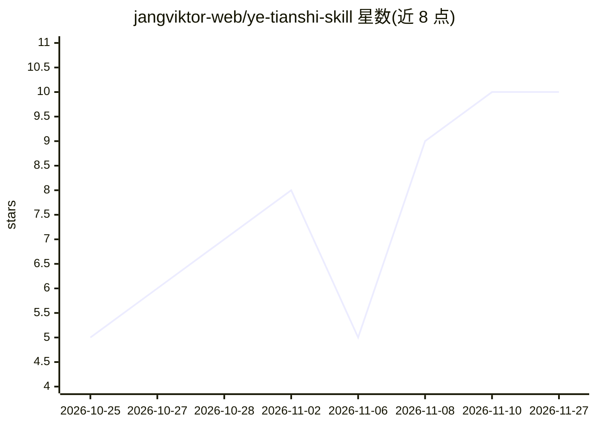

# jangviktor-web/ye-tianshi-skill

⭐ 10 · Python · CC-BY-SA-4.0 · 推送 2026-10-08 · [GitHub](https://github.com/jangviktor-web/ye-tianshi-skill) · [官网](https://jangviktor-web.github.io/ye-tianshi-skill/) · 个人维护 · 中文 README

**中医学习者与 agent 用户：叶天士温病辨证知识技能包**

把清代医家叶天士的辨证体系蒸馏为可安装的 Agent Skill：含四部原著 10,338 行正典、215 案医案库、158 条古今病名映射、20 组剂量卡与 17 份维度分析。以角色规则（SKILL.md）、检索式语料与七条输出铁律约束生成，引文要求逐字检索命中；配套可重跑的 Python 核验脚本（仅标准库，非运行时依赖）。定位为文献学与医学史素材，不拟方、不诊断、不替代就医。支持 SkillHub 或 git clone 安装到客户端 skills 目录。

## 筛选速览

| 维度 | 判定 | 备注 |
|---|---|---|
| AI 角色 | `ai-knowledge` | 知识聚合/清单类 |
| 许可风险 | `viral` | CC-BY-SA-4.0 |
| 部署形态 | `None` |  |
| 模型依赖 | — | README 未给出锁定关系 |
| 硬件要求 | — | 无带数字的原话,不猜 |
| 安装摩擦 | `low` | 无编译、无系统依赖或容器化 |
| 成熟度 | — | 结构信号不足 |

## 能力要点

- 四部原著 10,338 行可 grep 正典与 215 案医案库
- 158 条古今病名双向映射与 20 组剂量卡
- 七条输出铁律：引文逐字检索、不编造、检索降级
- 引文核验与剂量复核脚本可重跑（退出码验证）

## 适用场景

- 让 AI 以叶氏视角做病证条辨与读案教学
- 查询古今病名在温病门类中的对应与出处
- 温病流派与经方派的观点辩难比较
- 中医经典原文的逐字检索与引文核验

## 场景标签

`提示工程` `科研工具` `知识库管理` · 领域:Agent 开发

## 证据(README 行号)

> L7: `四部原著` · `10,338行原文` · `约46万字` · `215案医案` · `158条古今病名映射` · `20组剂量卡` · `17份维度分析` · `29问FAQ` · `6组内在张力`
> L23: 将叶天士（1667—1746，名桂，字天士，号香岩）的**卫气营血辨证坐标系**、脾胃分治与养胃阴说、阳化内风、久病入络、奇经八脉六套框架，连同其用药禁忌、剂量思维与清代文人医家口吻，蒸馏为可激活的 Agent Skill，使 A
> L193: 1. **引原文禁默写**——凡引方药必须先检索库内原文逐字引用；检不到者标"（原文未标注剂量）"，禁止凭记忆补白

## 星数曲线

2026-10-25 5 → 2026-11-27 10（+5）

---
*卡片 v1 · prompt 1.4 · 生成 2026-11-19 · 置信度 high · 依据 README sha `20b559412bd2` · [字段定义](../../DATASET.md)*
