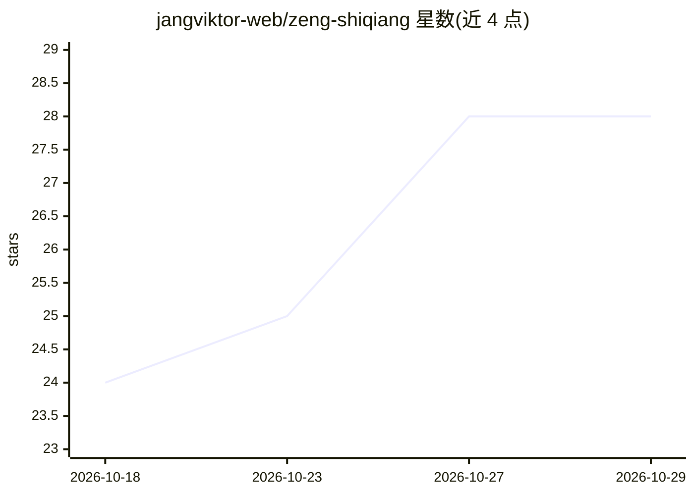

# jangviktor-web/zeng-shiqiang

⭐ 28 · Python · 推送 2026-08-27 · [GitHub](https://github.com/jangviktor-web/zeng-shiqiang) · 个人维护 · 中文 README

**曾仕强管理学与国学知识蒸馏的 Agent Skill 资源库**

基于曾仕强著作、电视节目与公开演讲材料构建的 Agent Skill 知识库：将 40 本著作（含《中国式管理全集》23 册）蒸馏为 48 个模块，整理为标准化 Markdown，含 SKILL.md 主技能文件、85+ 心智模型、决策启发式与口语风格模块。支持 RAG 检索、LLM 微调、AI 蒸馏与 Agent 调用，提供 git clone 手动安装、ClawHub/SkillHub（腾讯云）、腾讯 IMA 商场等多种安装途径。声明遵循 MulanPSL-2.0 协议，内容仅供学术研究与角色演绎。

## 筛选速览

| 维度 | 判定 | 备注 |
|---|---|---|
| AI 角色 | `ai-knowledge` | 知识聚合/清单类 |
| 许可风险 | `none` | — |
| 部署形态 | `library` | 以包/库形式分发 |
| 模型依赖 | — | README 未给出锁定关系 |
| 硬件要求 | — | 无带数字的原话,不猜 |
| 安装摩擦 | `low` | 无编译、无系统依赖或容器化 |
| 成熟度 | — | 结构信号不足 |

## 能力要点

- 40 本著作蒸馏为 48 个模块（含《中国式管理全集》23 册全量拆分）
- SKILL.md 主技能文件含角色规则、心智模型、决策启发式与表达 DNA
- 内置索引全面性自测脚本（dim7 7/7 PASS，48 模块/211 关键词）
- 多渠道安装：git clone / ClawHub / SkillHub（腾讯云）/ 腾讯 IMA

## 适用场景

- 让 AI Agent 以曾仕强视角回应管理、处世、易经等问题
- 作为中国式管理与国学的 RAG 检索知识源
- 导入 Obsidian 构建个人国学知识库
- 本地大模型调用私有国学 Skill

## 场景标签

`精选清单` · 领域:学习与行业

## 证据(README 行号)

> L20: 将曾仕强（1934–2018）的中国式管理、易经义理、道德经智慧、人际相处、领导之道，蒸馏为可激活的 Agent Skill，使 AI 能以曾仕强的视角回应管理、处世、解读易理、修身齐家。
> L30: cp -r zeng-shiqiang/ ~/.claude/skills/zeng-shiqiang/

## 星数曲线

2026-10-18 24 → 2026-10-29 28（+4）

---
*卡片 v1 · prompt 1.4 · 生成 2026-10-27 · 置信度 high · 依据 README sha `97d75372dec6` · [字段定义](../../DATASET.md)*
