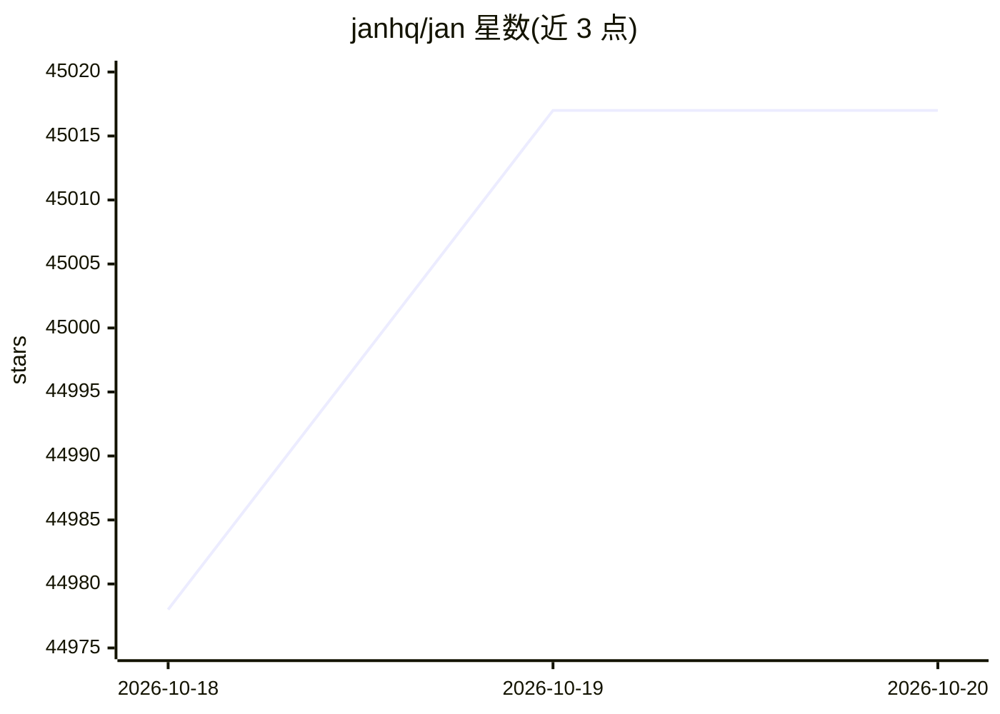

# janhq/jan

⭐ 45,017 · Rust · NOASSERTION · 推送 2026-10-19 · [GitHub](https://github.com/janhq/jan) · [官网](https://jan.ai/) · 组织维护

**给个人用户的本地离线 LLM 客户端：下载并运行模型**

基于 Tauri 与 llama.cpp 的桌面应用，可在本地下载并运行 HuggingFace 上的 LLM（Llama、Gemma、Qwen 等）。支持接入 OpenAI、Anthropic、Groq、Mistral 等云端模型，提供 localhost:1337 的 OpenAI 兼容 API 服务器，并集成 MCP 以支持 agent 能力。提供 Windows/macOS/Linux 安装包与源码构建途径，Apache 2.0 许可。

## 筛选速览

| 维度 | 判定 | 备注 |
|---|---|---|
| AI 角色 | `ai-native` | 本体是模型或模型工具 |
| 许可风险 | `none` | NOASSERTION |
| 部署形态 | `desktop` | 安装包/桌面程序 |
| 模型依赖 | locked-api |  |
| 硬件要求 | — | 无带数字的原话,不猜 |
| 安装摩擦 | `high` | 编译与系统依赖俱全 |
| 成熟度 | — | 结构信号不足 |

## 动量与使用信号

- 维护:`active` — 距上次 push 1.9 天,年发版 14,161 位贡献者
- 涨星:近 1 天 **+15**(自 20261016 起算)
- 平台:WINDOWS / MACOS / LINUX · 协议:OPENAI-API / MCP

## 能力要点

- 本地下载并运行 HuggingFace 上的 LLM
- localhost:1337 提供 OpenAI 兼容 API 服务器
- MCP 集成支持 agentic 能力
- 多种引擎变体（cpu/vulkan/metal/cuda12/cuda13/hip）

## 适用场景

- 在无网络或注重隐私的环境下离线运行本地大模型
- 把本地模型作为 OpenAI 兼容 API 供其他应用调用
- 通过 MCP 让本地模型执行 agent 任务

## 场景标签

`聊天机器人` `推理引擎` · 领域:对话与助手

## 证据(README 行号)

> L62: - **Local AI Models**: Download and run LLMs (Llama, Gemma, Qwen, GPT-oss etc.) from HuggingFace
> L63: - **Cloud Integration**: Connect to GPT models via OpenAI, Claude models via Anthropic, Mistral, Groq, MiniMax, and
> L65: - **OpenAI-Compatible API**: Local server at `localhost:1337` for other applications

## 星数曲线

2026-10-18 44,978 → 2026-10-20 45,017（+39）

---
*卡片 v1 · prompt 1.4 · 生成 2026-10-18 · 置信度 high · 依据 README sha `d57be3b9a58d` · [字段定义](../../DATASET.md)*
