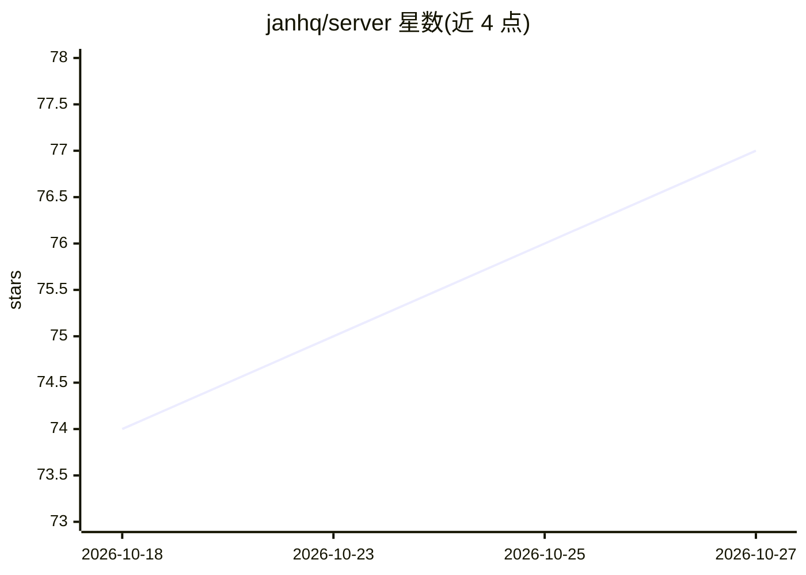

# janhq/server

⭐ 77 · Go · 推送 2026-06-21 · [GitHub](https://github.com/janhq/server) · [官网](https://chat.jan.ai) · 组织维护

**自托管微服务 LLM API 平台，带 MCP 工具集成**

Jan Server 是以 Docker Compose 部署的微服务 LLM API 平台，面向需要在自有环境运行 LLM 服务的团队。提供 OpenAI 兼容的 chat completions API、多步工具编排的 Response API、S3 媒体管理、MCP 工具（搜索/抓取/代码执行），以及 Keycloak OIDC 认证、Kong 网关和 Prometheus/Grafana/Jaeger 可观测性。推理后端可选本地 vLLM 或远程 OpenAI 兼容端点；附 React 聊天 UI 与 jan-cli 命令行工具。需 8GB 内存起步，GPU 为可选项。

## 筛选速览

| 维度 | 判定 | 备注 |
|---|---|---|
| AI 角色 | `ai-ecosystem` | LLM/agent 周边工具 |
| 许可风险 | `none` | — |
| 部署形态 | `self-host` | docker 或自建部署 |
| 模型依赖 | local-ok | 支持本地模型 |
| 硬件要求 | `cpu-ok` | |
| 安装摩擦 | `low` | 无编译、无系统依赖或容器化 |
| 成熟度 | — | 结构信号不足 |

## 能力要点

- OpenAI 兼容 chat completions API 与流式输出
- Response API 多步 MCP 工具编排（深度上限 8、超时 45s）
- Keycloak OIDC 认证 + Kong 网关 + OpenTelemetry 全链路可观测
- Docker Compose 多 profile 与 Kubernetes/Helm 部署支持

## 适用场景

- 在企业内网自建 OpenAI 兼容的 LLM 服务
- 为 agent 工作流提供带 MCP 工具的多步编排 API
- 统一管理对话、媒体与搜索抓取等 AI 服务并监控运行状态

## 场景标签

`推理引擎` · 领域:训练与推理

## 证据(README 行号)

> L63: - **OpenAI-compatible API** for chat completions and conversations
> L66: - **MCP (Model Context Protocol)** tools for web search, scraping, and code execution

## 星数曲线

2026-10-18 74 → 2026-10-27 77（+3）

---
*卡片 v1 · prompt 1.4 · 生成 2026-10-24 · 置信度 mid · 依据 README sha `55f6ea26abc9` · [字段定义](../../DATASET.md)*
