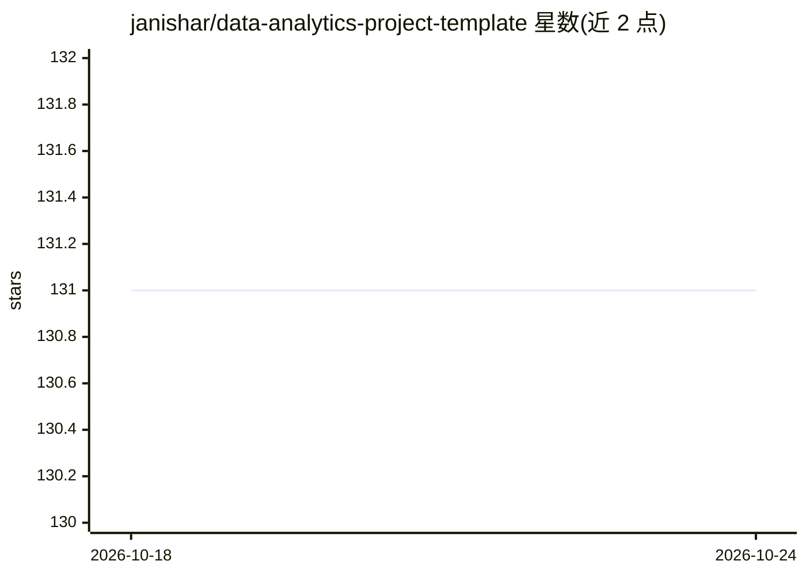

# janishar/data-analytics-project-template

⭐ 131 · Jupyter Notebook · Apache-2.0 · 推送 2026-02-03 · [GitHub](https://github.com/janishar/data-analytics-project-template) · 个人维护

**数据分析与机器学习项目的 Python 起步模板**

面向数据分析和数据科学从业者的 Python 项目结构模板，面向 Visual Studio Code 设计但可在任意 IDE 使用。内置 Jupyter Notebook、Pandas、matplotlib、numpy、seaborn 支持，data 目录默认 git 忽略，提供模块查找器用于代码共享，并提供 vscode 任务生成分析模块目录。使用方式为安装 Conda（可选安装 vscode）、克隆仓库、解压测试数据并运行示例 notebook。

## 筛选速览

| 维度 | 判定 | 备注 |
|---|---|---|
| AI 角色 | `ai-ecosystem` | LLM/agent 周边工具 |
| 许可风险 | `permissive` | Apache-2.0 |
| 部署形态 | `None` |  |
| 模型依赖 | — | README 未给出锁定关系 |
| 硬件要求 | — | 无带数字的原话,不猜 |
| 安装摩擦 | `low` | 无编译、无系统依赖或容器化 |
| 成熟度 | — | 结构信号不足 |

## 能力要点

- 预置 Jupyter/Pandas/matplotlib/numpy/seaborn 项目结构
- vscode 任务一键生成分析模块目录
- data 目录默认 git 忽略，含模块查找器用于代码共享

## 适用场景

- 快速搭建数据分析/机器学习项目的目录结构
- 在 vscode 中按模块组织 notebook 分析任务
- 团队内以统一结构启动多个分析项目

## 场景标签

 · 领域:数据科学/项目工程

## 证据(README 行号)

> L2: A project template to quick start data analytics and machine learning task.
> L5: It is convenient to adopt a good project structure having support of git when starting with a project for data analy

## 星数曲线

2026-10-18 131 → 2026-10-24 131（+0）

---
*卡片 v1 · prompt 1.4 · 生成 2026-10-22 · 置信度 high · 依据 README sha `205011b1ec35` · [字段定义](../../DATASET.md)*
