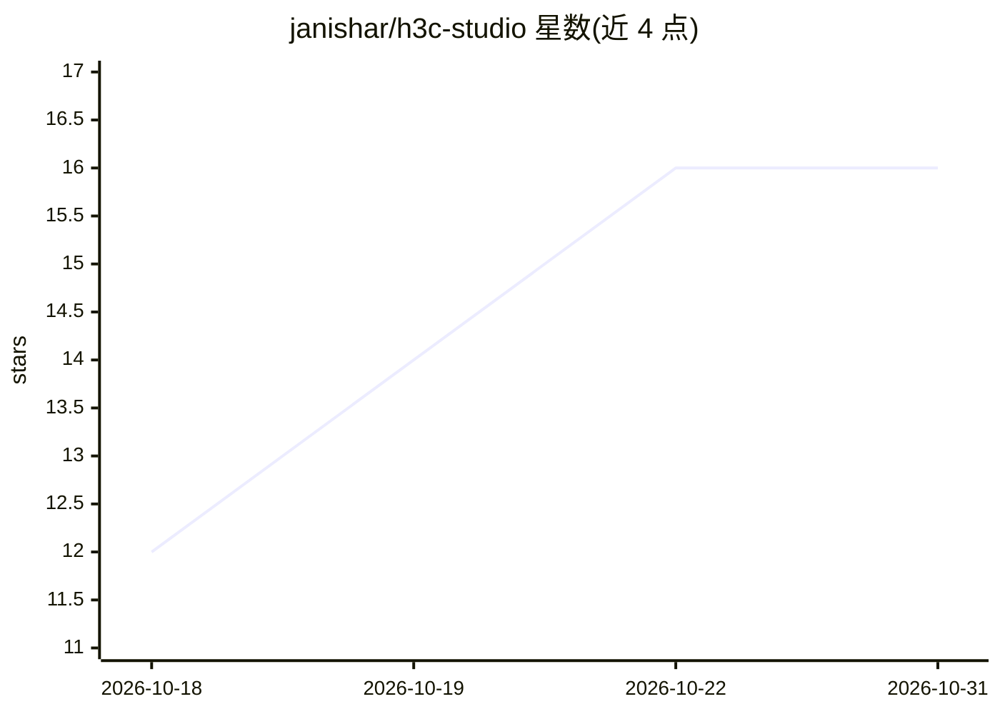

# janishar/h3c-studio

⭐ 16 · Go · MIT · 推送 2026-10-13 · [GitHub](https://github.com/janishar/h3c-studio) · 个人维护

**在 Apple Silicon 上本地驱动 h3.c 生成 MiniMax-H3 视频音频的 Web 工作台**

用 Go 编写的本地 Web 服务（无 JS 构建步骤、单一 Go 依赖），封装 h3.c 二进制：构建 CLI 参数、运行单次或交互式会话、管理参考图与锚点、排队渲染、串联镜头并分析性能，全程不离开本机。依赖 helmstudio 启动器安装与托管，自身不会独立启动。硬性限定 Apple Silicon Mac（Metal/MPS/Accelerate，无 Intel、无非 Apple GPU），完整 checkpoint 约 196 GB（去重后约 66 GB），需自行准备本地 MiniMax-H3 模型，界面无身份认证。

## 筛选速览

| 维度 | 判定 | 备注 |
|---|---|---|
| AI 角色 | `ai-native` | 本体是模型或模型工具 |
| 许可风险 | `permissive` | MIT |
| 部署形态 | `library` | 以包/库形式分发 |
| 模型依赖 | — | README 未给出锁定关系 |
| 硬件要求 | — | 无带数字的原话,不猜 |
| 安装摩擦 | `high` | 编译与系统依赖俱全 |
| 成熟度 | — | 结构信号不足 |

## 能力要点

- 驱动 h3.c 的原生 Metal 实现，无 PyTorch/MLX 依赖
- 会话、渲染队列、镜头串联与性能分析均在浏览器内完成
- 数据全部留在本机，仅绑定 127.0.0.1（无认证）
- 去重下载权重可将磁盘占用从约 196 GB 降至约 66 GB

## 适用场景

- 在 Apple Silicon Mac 上本地生成 MiniMax-H3 视频/音频，不装 Python 栈
- 用参考图和锚点做参考条件生成与镜头串联
- 通过 helmstudio 启动器一键安装并纳入共享素材库管理

## 场景标签

`视频生成` · 领域:内容生成

## 证据(README 行号)

> L3: **A local web studio for h3.c** — native
> L7: `h3` binary: it builds the CLI arguments, runs one-shot or interactive sessions,
> L9: profiling — in a browser tab, nothing sent off your machine. It runs as a

## 星数曲线

2026-10-18 12 → 2026-10-31 16（+4）

---
*卡片 v1 · prompt 1.4 · 生成 2026-10-30 · 置信度 high · 依据 README sha `e795639f8721` · [字段定义](../../DATASET.md)*
