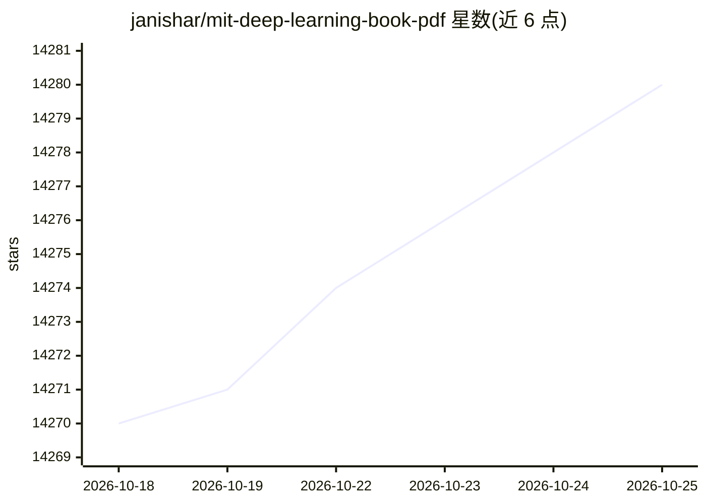

# janishar/mit-deep-learning-book-pdf

⭐ 14,280 · Java · 推送 2026-02-03 · [GitHub](https://github.com/janishar/mit-deep-learning-book-pdf) · 个人维护

**为学习者提供 MIT 深度学习教材的 PDF 版本**

将 MIT Press《Deep Learning》（Ian Goodfellow、Yoshua Bengio、Aaron Courville 著）的 HTML 免费版本排版装订为 PDF，提供完整全书与分章节两种 PDF 下载。README 说明原书官网不提供 PDF 下载，作者按官网建议以 Chrome 打印 HTML 内容制作本版本；另收录练习题、讲义幻灯片与外部链接等学习资源入口，并引导读者购买纸质书支持原作者。

## 筛选速览

| 维度 | 判定 | 备注 |
|---|---|---|
| AI 角色 | `ai-knowledge` | 知识聚合/清单类 |
| 许可风险 | `none` | — |
| 部署形态 | `None` |  |
| 模型依赖 | — | README 未给出锁定关系 |
| 硬件要求 | — | 无带数字的原话,不猜 |
| 安装摩擦 | `low` | 无编译、无系统依赖或容器化 |
| 成熟度 | — | 结构信号不足 |

## 动量与使用信号

- 维护:`declining` — 距上次 push 256.6 天,年发版 0,7 位贡献者
- 涨星:近 1 天 **+1**(自 20261016 起算)

## 能力要点

- 提供完整全书 PDF 与分章节 PDF 两种形式
- 内容源自官方免费 HTML 版本（deeplearningbook.org）
- 收录练习题、讲义幻灯片与外部链接清单

## 适用场景

- 离线阅读深度学习教材
- 按章节选择性查阅特定主题
- 配合练习题与讲义自学

## 场景标签

`教程课程` · 领域:学习与行业

## 证据(README 行号)

> L6: MIT Deep Learning Book in PDF format (complete and parts) by Ian Goodfellow, Yoshua Bengio and Aaron Courville.
> L38: 1. The pdf version of the book which is available in html at http://www.deeplearningbook.org/
> L39: 2. The book is available in chapter wise PDFs as well as complete book in PDF.

## 星数曲线

2026-10-18 14,270 → 2026-10-25 14,280（+10）

---
*卡片 v1 · prompt 1.4 · 生成 2026-10-18 · 置信度 high · 依据 README sha `fce1da321a00` · [字段定义](../../DATASET.md)*
