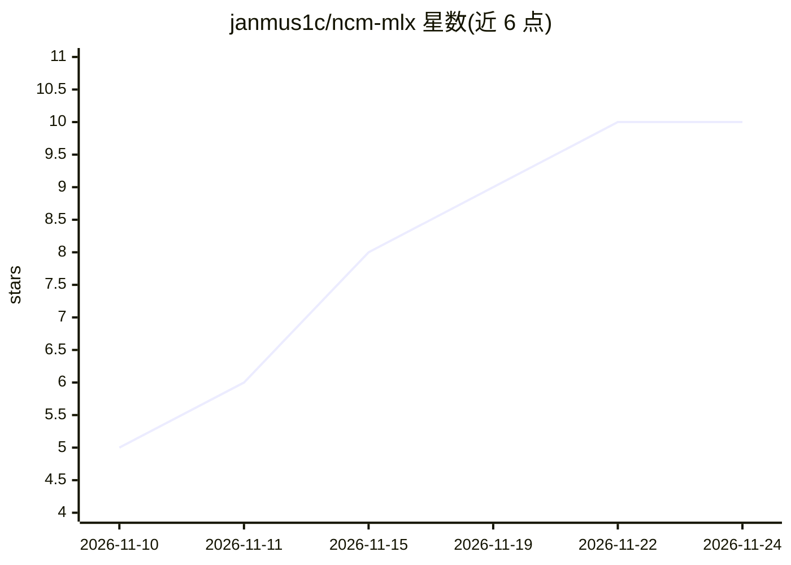

# janmus1c/ncm-mlx

⭐ 11 · Python · MIT · 推送 2026-11-08 · [GitHub](https://github.com/janmus1c/ncm-mlx) · [官网](https://janmus1c.github.io/ncm-mlx/) · 个人维护

**在 Apple Silicon GPU 上运行与训练 NCM 非自回归文本生成模型**

HazyResearch Next-Concept Modeling 方法的独立 MLX 实现：以整层并行输出的粗到细方式生成文本（每层一次模型调用，替代逐 token 生成），提供 TinyStories、Sudoku、XSum 已发布检查点在 Apple Silicon GPU 上的推理，并支持在 Metal 或 CUDA 上从零训练小型 NCM 模型。包含与上游 PyTorch 输出的对齐验证脚本与基准测试，README 明确记录自训模型在文本上落后于自回归基线。以 pip 包发布，研究代码，非聊天模型，与 Stanford/HazyResearch 无关联。

## 筛选速览

| 维度 | 判定 | 备注 |
|---|---|---|
| AI 角色 | `ai-native` | 本体是模型或模型工具 |
| 许可风险 | `permissive` | MIT |
| 部署形态 | `library` | 以包/库形式分发 |
| 模型依赖 | — | README 未给出锁定关系 |
| 硬件要求 | — | 无带数字的原话,不猜 |
| 安装摩擦 | `medium` | 含编译或系统依赖之一 |
| 成熟度 | `idea` | |

## 能力要点

- 在 Apple Silicon GPU 上以 MLX 运行已发布的 TinyStories/Sudoku/XSum 检查点，测试用例中输出与上游 PyTorch 一致
- 支持从零训练小型 NCM 模型（Metal 或 CUDA）
- 提供完整基准测试表、延迟数据与对齐验证脚本
- 提供 Zenodo 软件 DOI 与工作论文引用元数据（CITATION.cff）

## 适用场景

- 在 Mac 上运行粗到细并行文本生成实验
- 从零训练小型 NCM 模型做研究对比
- 复现或扩展论文中的基准与消融实验

## 场景标签

`模型训练` · 领域:训练与推理

## 证据(README 行号)

> L19: An independent MLX implementation of Next-Concept Modeling, the method of Kumbong et al. (HazyResearch). NCM writes
> L29: Two models are trained one after the other. The codec compresses text into a ladder of discrete codes; each finer l
> L37: python -m ncm_mlx official generate --task tinystories --n 2 --levels   # stories refined level by level

## 星数曲线

2026-11-10 5 → 2026-11-24 10（+5）

---
*卡片 v1 · prompt 1.4 · 生成 2026-11-20 · 置信度 high · 依据 README sha `38cc56a85b21` · [字段定义](../../DATASET.md)*
