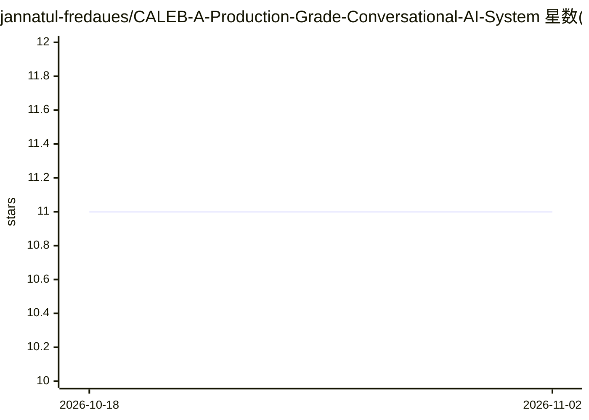

# jannatul-fredaues/CALEB-A-Production-Grade-Conversational-AI-System

⭐ 11 · Python · 推送 2026-04-25 · [GitHub](https://github.com/jannatul-fredaues/CALEB-A-Production-Grade-Conversational-AI-System) · [官网](https://www.linkedin.com/posts/jannatul-ferdaues_happy-to-share-that-after-trying-and-experimenting-ugcPost-7448005311161966592-7ypJ?utm_source=share&utm_medium=member_desktop&rcm=ACoAAD5dS0UBtKBM1IHle1Ft3emuz2kAcwb_M1o) · 个人维护

**基于规则/AI 模型的简易对话聊天机器人**

用 Python 编写的聊天机器人项目，通过预定义规则或 AI 模型对用户输入生成自动回复，面向学习、客服支持等场景，也可作为构建更高级对话系统的起点。功能包括实时交互、可定制的回复与基础 HTML/CSS 界面；README 未说明具体接入的模型、API 或安装运行命令，自述为简单聊天机器人并宣称具备生产级架构。

## 筛选速览

| 维度 | 判定 | 备注 |
|---|---|---|
| AI 角色 | `ai-native` | 本体是模型或模型工具 |
| 许可风险 | `none` | — |
| 部署形态 | `None` |  |
| 模型依赖 | — | README 未给出锁定关系 |
| 硬件要求 | — | 无带数字的原话,不猜 |
| 安装摩擦 | `low` | 无编译、无系统依赖或容器化 |
| 成熟度 | — | 结构信号不足 |

## 能力要点

- 基于预定义规则或 AI 模型生成自动回复
- 实时用户交互与可定制回复
- Python + NLP 技术与基础 HTML/CSS 界面

## 适用场景

- 学习对话式 AI 系统的构建方式
- 作为客服自动回复的基础模板
- 在其上扩展互联网搜索问答等能力

## 场景标签

`聊天机器人` · 领域:对话与助手

## 证据(README 行号)

> L2: This project is a simple chatbot designed to interact with users and provide automated responses based on predefined
> L12: 2. NLP / AI techniques

## 星数曲线

2026-10-18 11 → 2026-11-02 11（+0）

---
*卡片 v1 · prompt 1.4 · 生成 2026-11-02 · 置信度 low · 依据 README sha `812bbe3a46fd` · [字段定义](../../DATASET.md)*
